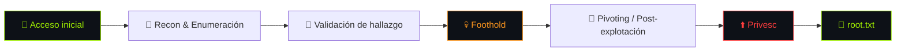

<div align="center">

<!-- Banner ASCII -->
```
██╗  ██╗██╗   ██╗██████╗  ██████╗ 
██║ ██╔╝██║   ██║██╔══██╗██╔═████╗
█████╔╝ ██║   ██║██████╔╝██║██╔██║
██╔═██╗ ██║   ██║██╔══██╗████╔╝██║
██║  ██╗╚██████╔╝██║  ██║╚██████╔╝
╚═╝  ╚═╝ ╚═════╝ ╚═╝  ╚═╝ ╚═════╝ 
```

# ⚡ kur0s4k1 · HackTheBox Writeups


[](https://www.hackthebox.com/)
[](#-m%C3%A1quinas)
[](#-pro-labs)
[](#-m%C3%A1quinas)
[](#-c%C3%B3mo-est%C3%A1-escrito-cada-writeup)
[](https://github.com/kur0s4k1)

<!-- Terminal animada (SVG propio, sin dependencias externas) -->


<!-- Snake sobre la grilla de contribuciones (generado por GitHub Actions en la rama `output`) -->


</div>

---

> 🛡️ **Política de divulgación:** sólo se documentan máquinas **retiradas** (o con permiso expreso de la plataforma). En la versión pública las **flags, contraseñas y claves van enmascaradas** (`deadb33f****`, `C0ntr4s****`) para no regalar hashes a quien esté resolviendo el box. Los procedimientos, comandos y evidencia quedan íntegros.

---

## 📡 Qué vas a encontrar aquí

Writeups **de operaciones reales**, no resúmenes de 5 líneas. Cada máquina se documenta como se vivió:

- 🧭 **Metodología completa** — qué pistas llevaron de un hallazgo al siguiente y por qué se tomó cada decisión.
- 💥 **Comandos y payloads ejecutables** — tal cual se lanzaron, con su salida real.
- 🧨 **Anexo de fallos** — lo que *no* funcionó y por qué (aquí es donde se aprende de verdad).
- 📸 **Evidencia visual por fases** — capturas numeradas por etapa del ataque.
- 🛠️ **Mitigaciones** — qué controles habrían roto la cadena.

<div align="center">



</div>

---

## 🖥️ Máquinas

| Máquina | OS | Dificultad | Cadena de ataque | Writeup |
|---|---|---|---|---|
| **Touch** (KIOSK-042) |  |  | Serial como contraseña → kiosk breakout (Edge → `cmd.exe`) → UDF de MySQL → **SYSTEM** | 📄 [Abrir](Machines/Windows/Facil/Touch/README.md) |
| **Layover** (airside-ws01) |  |  | RDP contractor → sniffing Wi-Fi en claro → RCE en Craft CMS → CUPS LPE (`CVE-2026-34990`) → **root** | 📄 [Abrir](Machines/Linux/Media/Layover/README.md) |
| **Stream** (stream) |  |  | Actuator/heapdump → credenciales ClickHouse → XXE (`lxml`) → SSH → ClickHouse `file()` + timer root → **root** | 📄 [Abrir](Machines/Linux/Media/Stream/README.md) |

<details>
<summary>💣 <b>Touch (KIOSK-042)</b> — Kiosk breakout → SYSTEM vía MySQL UDF</summary>

Kiosco de autoservicio de una aerolínea ficticia ("HTB Airways") sobre Windows, gestionado por el portal "Nexion DeviceHub" (8443).

1. **Fuga no autenticada.** `GET /api/status` entrega el número de serie del dispositivo sin autenticación, y ese serial **se reutiliza como contraseña del portal** → acceso al dashboard.
2. **Credenciales de la app → acceso remoto.** El dashboard muestra las credenciales de la cuenta de kiosco. WinRM la rechaza por política, pero **RDP la acepta** → sesión gráfica en el host.
3. **Kiosk breakout.** Apagando por API el escáner de pasaportes y la impresora se fuerza un **error de la aplicación de kiosco**; el diálogo de error abre **Microsoft Edge** vía enlace de soporte, y desde Edge `Ctrl+O` expone el **diálogo nativo de archivos** desde el que se lanza `cmd.exe`.
4. **Escalada a SYSTEM.** Credenciales de MySQL `root` en claro en un `.bat` + servicio **MySQL80 corriendo como `LocalSystem`** + permiso **Modify para Authenticated Users** en `C:\MySQL\lib\plugin` → DLL UDF `sys_eval` → `NT AUTHORITY\SYSTEM`.

📄 Writeup completo: [Machines/Windows/Facil/Touch](Machines/Windows/Facil/Touch/README.md)

</details>

<details>
<summary>✈️ <b>Layover</b> — RDP pivot → sniffing Wi-Fi → Craft CMS RCE → CUPS LPE</summary>

Entorno corporativo de aeropuerto sobre Linux. Host de paso (`airside-ws01`) con acceso RDP **y** presencia en una red Wi-Fi interna mal segmentada, más un portal de empleados y un Craft CMS en la red interna (*assumed breach*: se parte de credenciales válidas).

1. **Acceso inicial.** Credenciales de contratista válidas → **RDP** (xrdp/XFCE) a `airside-ws01`. La cuenta está en los grupos `sudo`, `netdev` y **`wireshark`**.
2. **Red interna por Wi-Fi.** `wlan2` conecta el host de paso a `10.13.37.0/24`; el portal cautivo anuncia el portal de empleados `portal.international.htb/miles/`.
3. **Captura en claro.** Abusando del grupo `wireshark` se pone `wlan2` en **modo monitor** y se esnifa un `POST` **HTTP** a `/miles/login.php` con `username`/`password`.
4. **RCE autenticada en Craft CMS 5.9.8.** El endpoint `element-search` instancia objetos desde JSON y un *behavior* de Yii2 apunta a `ConsoleProcessus::execute()` → ejecución ciega como `www-data` y webshell.
5. **Secretos y pivote.** `.env` → `CRAFT_SECURITY_KEY`; el secreto cifrado del relé de correo se descifra reutilizando la clave (Yii2 `Security`) → `aporter` → **SSH** → `user.txt`.
6. **Escalada a root.** **CUPS 2.4.16** (`CVE-2026-34990`): fuga del token de autenticación local de `cupsd` vía servidor IPP malicioso + escritura arbitraria con `device-uri` `file://` sobre `/etc/sudoers.d/` → `root.txt`.

📄 Writeup completo: [Machines/Linux/Media/Layover](Machines/Linux/Media/Layover/README.md)

</details>

<details>
<summary>🛫 <b>Stream</b> — Actuator/heapdump → XXE → SSH → ClickHouse file() + timer root</summary>

Servidor Linux que expone un pipeline de datos aeroportuarios (**Kafka → parser → ClickHouse**) con una API de ingesta AIDX (FastAPI, `:8081`) y una pasarela Spring Boot tras nginx (`:80`).

1. **Fuga de secretos.** Spring Boot Actuator expuesto → `GET /actuator/heapdump` → `strings` → credenciales del usuario ClickHouse `svc_events`.
2. **XXE (CWE-611).** El *worker* de parseo construye el parser `lxml` con `load_dtd=True, resolve_entities=True`. El resultado del parseo se **persiste en ClickHouse** → la entidad resuelta queda **consultable** (canal *in-band*): se leen ficheros locales arbitrarios del servicio.
3. **Credenciales → SSH.** Vía XXE se lee `server.properties` de Kafka → password SASL del usuario `svc_infra`, **reutilizada** como cuenta del sistema → **SSH** (foothold).
4. **Superficie de escalada.** `user.txt` vive en el home de `martin_cole` (accesible sólo por root/grupo) → el objetivo pasa a ser root. El *timer* **`aidx-dlq-drainer`** ejecuta cada 2 min, **como root**, un formateador alojado en `clickhouse/user_files/`.
5. **Root.** El usuario `default` de ClickHouse tiene el privilegio **`FILE`** → `INSERT INTO TABLE FUNCTION file(...)` **sobrescribe** el formateador → inyectando un mensaje en el **DLQ** (root tag inválido) el drainer root lo ejecuta → **root**.

📄 Writeup completo: [Machines/Linux/Media/Stream](Machines/Linux/Media/Stream/README.md)

</details>

---

## 🧪 Pro Labs

Entornos **multi-máquina** (Pro Labs / Mini Labs) documentados como **engagement de Red Team completo**: operación vía **C2**, **Active Directory**, pivoting y post-explotación. Organizados **por dificultad** en tres niveles.

| Nivel | Carpeta | Descripción |
|:--:|---|---|
| 🟢 **Básico** | [`Pro-Labs/Basico/`](Pro-Labs/Basico) | Cadenas cortas (1–2 hosts), técnicas fundamentales, menor profundidad de pivoting |
| 🟠 **Intermedio** | [`Pro-Labs/Intermedio/`](Pro-Labs/Intermedio) | Entornos AD híbridos, C2, movimiento lateral, 2–4 hosts |
| 🔴 **Avanzado** | [`Pro-Labs/Avanzado/`](Pro-Labs/Avanzado) | Bosques múltiples, evasión, cadenas largas y operación compleja |

| Lab | Nivel | Hosts | C2 | Cadena de ataque | Writeup |
|:--|:--:|:--|:--:|:--|:--:|
| **Puppet** | 🔴 Avanzado | `PUPPET-PM01` · `FILE01` · `DC01` | Sliver | FTP anónimo → Sliver C2 → PrintNightmare → Puppet code injection → DC01 → **SharpDPAPI** | 📄 [Abrir](Pro-Labs/Avanzado/Puppet/README.md) |

> Índice completo de Pro Labs (niveles, criterio de clasificación y estructura): [`Pro-Labs/README.md`](Pro-Labs/README.md)

<details>
<summary>🎯 <b>Puppet</b> — Sliver C2 → PrintNightmare → Puppet Code Execution → DC01</summary>

Mini Pro Lab (Red Team Operator I) diseñado para practicar operaciones de **C2 en un entorno AD híbrido**. Se parte de un **beacon Sliver ya activo** en `FILE01` y la cadena incluye explotación de PrintNightmare, pivote vía SSH y movimiento lateral usando Puppet.

1. **Acceso inicial (FTP + Sliver).** FTP anónimo en `10.13.38.33` entrega configuración del cliente Sliver (`red_127.0.0.1.cfg`) y el binario `sliver-client_linux`. Se establece un túnel con `socat` hacia el C2 interno (`31337`) y se conecta el cliente Sliver.
2. **Beacon en FILE01.** El beacon inicial ya corre como `svc_puppet_win_t0` en `FILE01`. Se usa para enumeración y **escalada a SYSTEM** vía **PrintNightmare (CVE-2021-34527)** en el servicio de impresión.
3. **Dump de credenciales.** Con SYSTEM en FILE01 se extraen credenciales de LSASS (Mimikatz/sekurlsa). Se obtienen credenciales válidas para `svc_puppet_lin_t1` (SSH key en DC01).
4. **Pivote a PUPPET (Linux).** Se descarga la clave SSH privada de `svc_puppet_lin_t1` desde `\\dc01.puppet.vl\it\.ssh\ed25519`, se crackea el passphrase (john + rockyou), y se conecta vía SSH a `172.16.40.200` (PUPPET-PM01).
5. **Escalada a root en PUPPET.** Se usa **Puppet code injection** (GTFOBins: `puppet apply` con manifest malicioso) para ejecutar comandos como root.
6. **Movimiento lateral a DC01.** En el Puppet Master se crea un manifest que ejecuta `puppet-update.exe` (Sliver implant) en `DC01` cuando el agente Puppet hace check-in. Nuevo beacon en DC01 como `svc_puppet_win_t0`.
7. **Flag final.** En DC01 se usa **SharpDPAPI** para decryptar credenciales DPAPI del Task Scheduler. La flag es la **contraseña de `PUPPET\root`**.

📄 Writeup completo: [Pro-Labs/Avanzado/Puppet](Pro-Labs/Avanzado/Puppet/README.md)

</details>

---

## 🧠 Cómo está escrito cada writeup

Estructura fija, pensada para que cualquiera pueda seguir la cadena de ataque y entender el razonamiento:

```
0. Resumen ejecutivo     → la cadena en 6 pasos, el "quién, cómo y desde dónde"
1. Recon                 → superficie expuesta y primeras decisiones
2..N. Cadena de ataque   → cada paso con comandos, salidas reales y las PISTAS
                           que llevaron al siguiente hallazgo
Anexo A. Intentos fallidos → lo que NO funcionó y por qué (la parte valiosa)
Anexo B. Indicadores     → endpoints, credenciales (enmascaradas), gadget, CVE
Anexo C. Cronología      → el ataque de un vistazo (ASCII)
```

**Principio:** una flag sin contexto no enseña nada. Aquí el valor está en **cómo se llegó a ella** — qué pista del entorno la delató, qué suposición falló antes, y qué técnica cerró el paso.

---

## 🛠️ Arsenal habitual


---

<div align="center">

### 📊 Estadísticas


---

> *"Root no es el final del writeup. Es el final de la cadena."*

**kur0s4k1** · writeups en español, orientados a metodología · [GitHub](https://github.com/kur0s4k1)

</div>
